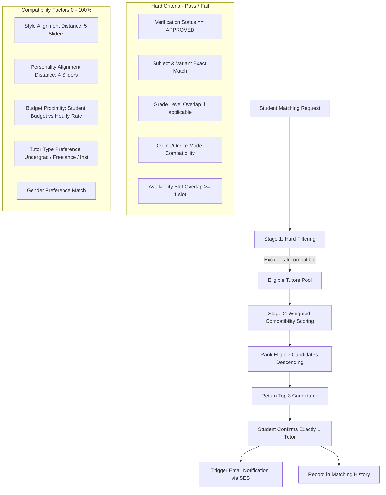

# TutorPair — Project Context & AI Agent Specification

> **Audience**: AI Agents (OpenAI GPT, Google Gemini, Anthropic Claude, Cursor, Copilot) and Human Developers.  
> **Purpose**: Single source of truth for TutorPair's domain, business rules, matching algorithm, database schema expectations, and architectural patterns.

---

## 1. Executive Summary & Problem Statement

### The Problem in Thailand
In Thailand, primary and secondary students (Grades 1–12) and their parents face critical bottlenecks when looking for private tutors:
1. **Scattered Information**: Tutor discovery relies on fragmented social media groups (Facebook, Line) and word-of-mouth.
2. **Lack of Credential Verification**: Tutors rarely undergo credential checks; educational degrees, standardized test scores (IELTS, SAT, TGAT/TPAT), and transcripts cannot be independently verified by parents.
3. **Multi-Factor Mismatch**: Finding the right tutor requires harmonizing multiple strict criteria (budget, schedule, location/online) alongside pedagogical alignment (learning pace, teaching style, personality fit). Manual selection leads to high failure rates and wasted resources.

### The Solution: TutorPair
TutorPair is a cloud-native platform providing:
* **Role-Based Profiles**: Structured onboarding for Students, Tutors, and Administrators.
* **Document Verification Workflow**: Mandatory admin review of degrees, CVs, and score certifications before a tutor enters the matching pool.
* **Rule-Based & Weighted Matchmaking**: Two-stage matching pipeline:
  1. *Hard Filters*: Eliminates incompatible tutors (grade, subject/variant, availability, location mode).
  2. *Weighted Compatibility Scoring*: Ranks candidates using pedagogical style, personality traits, budget fit, and preferences.
* **Top 3 Recommendations & 1-Tutor Commitment**: Recommends the Top 3 best matches; student confirms exactly 1 tutor.
* **Verified Reviews**: Review submission is strictly restricted to students who confirmed that tutor, evaluated on 4 concrete dimensions.

---

## 2. Key Users & Role-Based Permissions

| Role | Primary Responsibilities & Scope | Permissions / Constraints |
|---|---|---|
| **Student** | • Manage student profile & learning preferences.<br>• Submit matching requests via 3-step subject cascading selection.<br>• Answer 1–5 style & personality preference sliders.<br>• Review Top 3 matched tutors (CV, credentials, past ratings).<br>• Confirm exactly 1 tutor.<br>• View matching history and submit 4-category reviews. | • Can only review tutors they previously confirmed.<br>• Cannot access admin endpoints.<br>• Free-text teaching focus is disabled. |
| **Tutor** | • Manage profile (hourly rate, bio, subjects, availability).<br>• Answer 1–5 teaching style & personality sliders.<br>• Upload verification documents (Degree/Transcript, CV, Test certificates).<br>• Enter optional `teaching_focus` text for specialized offerings.<br>• Receive notifications when selected or when verification status changes. | • Cannot appear in matching results until status = `APPROVED`.<br>• Cannot alter own verification status.<br>• Maximum 10MB per document, 100MB total uploads. |
| **Admin** | • Access Admin Verification Dashboard.<br>• Review pending tutor applications & inspect uploaded verification docs via secure S3 Presigned URLs.<br>• Approve or reject applications (mandatory rejection reason).<br>• Audit user roles and system status. | • Full visibility into private documents & applications.<br>• Immutable audit trail of approval/rejection decisions. |

---

## 3. Core Functional Flows & Business Rules

### 3.1. The "Grouped 3-Step" Subject Selection Flow
Both Students and Tutors specify subjects using a cascaded hierarchy:
1. **Step 1 — Category** (`SubjectCategory` enum):
   - `GENERAL_LEARNING` (e.g., Mathematics, Physics, Chemistry, Biology)
   - `LANGUAGE_TESTING` (e.g., IELTS, HSK, JLPT, TOEIC)
   - `UNIVERSITY_ENTRANCE` (e.g., SAT, TGAT, TPAT, A-Level)
2. **Step 2 — Subject** (Fetched dynamically from database):
   - Example: Under `LANGUAGE_TESTING`, select `Japanese`.
3. **Step 3 — Specific Variant** (`subject_variants` grouped by `learning_goal` enum):
   - Grouped under headers such as *Standardized Exams* vs. *Practical Application*.
   - Example: Under Japanese $\rightarrow$ `JLPT N1`, `JLPT N2`, `Daily Conversation`, `Business Japanese`.

#### Conditional UI Rules:
* **Grade Levels (G1–G12)**:
  - *Rendered*: Only when the selected variant belongs to school curriculum / general learning (e.g., `Math -> Primary School`).
  - *Hidden*: When variant is a standardized test (e.g., `IELTS`, `SAT`, `TGAT`).
* **Teaching Focus (`teaching_focus`)**:
  - *Tutors Only*: Optional free-text field for specialized niche (e.g., "American accent focus", "Kangaroo Math").
  - *Students*: Hidden.
* **Document Upload Requirement**:
  - If a selected subject variant has `requires_proof = true` (e.g., JLPT N1, IELTS 8.0, SAT Math), the tutor onboarding dynamically requires uploading the respective test score certificate.

---

### 3.2. Style & Personality Matching (1–5 Sliders)

Compatibility scoring relies on **identical semantic dimensions** answered on a 1–5 scale ($1 = \text{Strongly Left}$, $5 = \text{Strongly Right}$):

#### A. Learning Style (Student) vs. Teaching Style (Tutor) — 5 Sliders

| # | Student Prompt (Learning Style) | Tutor Prompt (Teaching Style) | Value 1 (Left) | Value 5 (Right) |
|---|---|---|---|---|
| **1** | I prefer learning... | I usually teach... | Step-by-step carefully | Focus on key points & move fast |
| **2** | I prefer... | I focus more on... | Doing a lot of practice exercises | Understanding the concept first |
| **3** | During class I like to... | I prefer... | Chat and discuss with the tutor | Quiet sessions focused on listening |
| **4** | I like tutors who... | I... | Guide me step-by-step | Let them explore independently |
| **5** | I prefer... | I make lessons... | A fun and relaxed atmosphere | Calm and focused |

#### B. Personality Preferences (Student) vs. Self-Personality (Tutor) — 4 Sliders

| # | Student Prompt (Personality Pref) | Tutor Prompt (Self-Personality) | Value 1 (Left) | Value 5 (Right) |
|---|---|---|---|---|
| **1** | I prefer a tutor who is... | I am usually... | Formal and polite | Casual and friendly |
| **2** | I want a tutor who is... | I... | Strictly follow schedules / Always on time | Flexible and adaptable depending on situation |
| **3** | I like tutors who are... | I'm... | Calm and gentle / composed | Energetic and lively / expressive |
| **4** | I prefer tutors who... | I motivate students by... | Focus on discipline / challenge | Encourage & relaxed atmosphere |

---

### 3.3. Two-Stage Matchmaking Algorithm



1. **Stage 1 — Hard Filters (Strict Boolean Gate)**:
   * Verification status must be `APPROVED`.
   * Subject variant match: Tutor must be certified/approved to teach the requested variant.
   * Grade level match: If subject variant is school-curriculum based, tutor must support the student's grade.
   * Mode: `ONLINE`, `ONSITE`, or `BOTH`.
   * Availability: At least 1 overlapping time slot (Day of week + time range).
2. **Stage 2 — Weighted Compatibility Scoring**:
   * Measures Euclidean / Manhattan distance across the 5 Style dimensions and 4 Personality dimensions.
   * Computes budget utility score based on student's max budget vs. tutor's rate.
   * Applies preference modifiers (Tutor Type, Gender).
   * Ranks candidates and produces the **Top 3 Recommendations**.
3. **Student Selection**:
   * Student inspects Top 3 profiles, ratings, and CV.
   * Confirms exactly **1 tutor**.
   * System writes the confirmed record to `matches` and enqueues an automated notification email to the tutor via Amazon SES.

---

### 3.4. Tutor Document Verification Flow

1. **Required Submissions**:
   * **Graduation Certificate** (for graduates) or **Academic Transcript** (for active undergraduates).
   * **Resume / CV**.
   * **Certificates/Credentials** mentioned on CV.
   * **Subject-Specific Qualification**: Triggered dynamically when a selected subject variant requires proof (e.g., SAT score report, IELTS certificate).
2. **Document Constraints**:
   * Max **10 MB** per individual document.
   * Max **100 MB** total storage quota per tutor.
   * Uploaded directly to private **Amazon S3** using presigned PUT URLs (client never streams file bytes through the Express backend).
3. **Admin Review**:
   * Admin inspects document via time-limited presigned GET URLs.
   * Status transitions: `PENDING` $\rightarrow$ `APPROVED` or `REJECTED`.
   * Rejections require an explicit reason text stored in database.
   * Status updates trigger an asynchronous notification email to the tutor.

---

### 3.5. Review & Rating Flow (4 Concrete Metrics)

Reviews are gated by system verification:
* **Gating**: A student can submit a review **only** for a tutor they previously confirmed from a Top 3 match.
* **Rating Dimensions (1–5 Stars each)**:
  1. **Knowledge**: Subject mastery and correctness.
  2. **Preparation**: Lesson planning, structured materials, and syllabus tracking.
  3. **Clarity**: Communication effectiveness and ability to explain complex topics.
  4. **Punctuality**: Timeliness and session reliability.
* **Feedback**: Optional free-text comment.
* **Aggregation**: Backend recomputes overall mean rating and review counts on the tutor profile.

---

## 4. Non-Functional Requirements & SLAs

* **Performance**:
  - Top 3 match calculation rendered within **< 3 seconds** under normal conditions.
  - Profile, review, matching history, and admin verification pages load within **< 2 seconds**.
  - Target met for at least **95%** of requests at up to **100 concurrent users**.
* **Scalability**:
  - Containerized backend on Amazon ECS Fargate auto-scales horizontally based on CPU/Memory thresholds.
  - Relational persistence on Amazon RDS PostgreSQL with connection pooling.
* **Reliability & Availability**:
  - Target **99% availability**.
  - Match calculation is deterministic given identical inputs and scoring weights.
  - Operations fail with clear error messages (`BadRequestError`, `NotFoundError`, etc.) rather than failing silently.
* **Security & Access Control**:
  - Role-based authorization (`STUDENT`, `TUTOR`, `ADMIN`) enforced via JWT middleware.
  - Passwords and secrets managed exclusively through **AWS Secrets Manager** and **AWS Cognito**; never in Git.
  - Private S3 documents protected with short-lived presigned URLs.
* **Privacy**:
  - Tutors must consent before CV or credential summaries are exposed to students.
  - Private verification documents (e.g. government ID or sensitive transcripts) are strictly restricted to Admin eyes.
* **Data Retention**:
  - Database automated backups retained for **7 days**.

---

## 5. Technology Stack & Infrastructure

```text
                                [ User Browser ]
                                       │
                         https://tutorpair.example.com
                                       │
                 ┌─────────────────────┴─────────────────────┐
                 ▼                                           ▼
      [ AWS Amplify Hosting ]                     [ Amazon Route 53 ]
      (React 18 + Vite SPA)                                  │
                                                             ▼
                                                [ Application Load Balancer ]
                                                             │
                                                  (ACM SSL Termination)
                                                             │
                                                             ▼
                                                [ Amazon ECS Fargate ]
                                                (Node.js / Express API)
                                                             │
                 ┌─────────────────────┬─────────────────────┼─────────────────────┐
                 ▼                     ▼                     ▼                     ▼
        [ Amazon RDS ]           [ Amazon S3 ]        [ Amazon Cognito ]     [ Amazon SES ]
        (PostgreSQL 16)         (Private Docs)          (Auth & JWT)        (Email Worker)
```

| Layer | Technologies / AWS Services | Description |
|---|---|---|
| **Frontend** | React 18, Vite, TypeScript, TanStack Query v5, Zustand, React Hook Form, Zod | Fast single-page application hosted on **AWS Amplify Hosting**. |
| **Backend** | Node.js 20+, Express.js, TypeScript, Drizzle ORM | RESTful API running in container on **Amazon ECS Fargate**. |
| **Database** | PostgreSQL 16 on **Amazon RDS** | Relational store for users, profiles, subjects, availability, matches, reviews, notifications. |
| **Storage** | **Amazon S3** | Secure bucket for tutor certificates, resumes, and avatar pictures. |
| **Authentication** | **AWS Cognito** + Google OAuth 2.0 | Managed user pools, tokens verified via `aws-jwt-verify`. Local mock mode supported. |
| **DNS & Networking** | **Route 53**, **ALB**, **ACM**, **AWS VPC** | Secure custom domains, SSL/TLS, and isolated subnets for database and containers. |
| **Notifications** | **Amazon SES** + Background Worker | Async polling worker (30-second interval) to dispatch queued email records. |
| **Observability** | **Amazon CloudWatch** | Centralized container logging and metrics. |

---

## 6. Monorepo Structure & Key Directory Map

```text
tutorpair/
├── packages/
│   └── shared/                 # @tutorpair/shared (Enums, Zod schemas, DTOs)
│       └── src/
│           ├── enums/          # UserRole, SubjectCategory, VerificationStatus, etc.
│           ├── schemas/        # Shared validation schemas for forms and API payloads
│           └── types/          # Shared TypeScript interfaces
│
├── apps/
│   ├── server/                 # Express backend (Port 4000)
│   │   └── src/
│   │       ├── common/         # Auth middlewares, error handlers, async wrapper
│   │       ├── config/         # Zod env schema, AWS SDK clients (S3, SES, Cognito)
│   │       ├── db/             # Drizzle schemas, migrations, seed data
│   │       │   └── schema/     # users, tutors, students, subjects, matches, reviews, etc.
│   │       ├── modules/        # Domain modules (auth, admin, students, tutors, matching, reviews)
│   │       └── workers/        # Notification email worker
│   │
│   └── client/                 # React frontend (Port 5173)
│       └── src/
│           ├── components/     # Reusable primitives (sliders, modal, cards)
│           ├── features/       # Feature views (auth, admin, matching, reviews, profile)
│           ├── layouts/        # Layout wrappers by user role
│           ├── services/       # Axios API client with token interceptors
│           └── store/          # Zustand client auth store
│
├── docs/                       # Detailed architectural references
├── PROJECT_CONTEXT.md          # This file — Full AI agent specification & context
├── AGENTS.md                   # Agent guidelines & rules of engagement
├── README.md                   # Quick start & repository overview
└── docker-compose.yml          # Local PostgreSQL 16 backing container
```

---

## 7. Guidelines for AI Agents Modifying This Codebase

1. **Shared Workspace First**:
   - Never duplicate enums or validation types in `apps/server` or `apps/client`.
   - Always modify `packages/shared/src/`, then compile via `npm run build:shared`.
2. **Preserve Determinism**:
   - The matching algorithm must remain rule-based and deterministic. Do not introduce non-deterministic or generative heuristics into the scoring formula.
3. **Mock Mode Awareness**:
   - Backend supports local mock authentication via `Authorization: Bearer mock-token-<user-id>`.
   - Do not break the mock auth branch in `common/middleware/auth.middleware.ts` when modifying security logic.
4. **S3 Direct Upload Principle**:
   - File binaries **must never** pass through Express route bodies. Use S3 presigned URLs (`PUT` for client upload, `GET` for view).
5. **Database Migration Standard**:
   - Schema changes in `apps/server/src/db/schema/` must be followed by `npm run db:generate` and committed as SQL migrations.
6. **Strict Flat Design Standard**:
   - All frontend user interfaces must adhere strictly to [**`docs/DESIGN_SYSTEM.md`**](./docs/DESIGN_SYSTEM.md) — zero drop shadows, no glassmorphism or blur, Outfit typography, and solid color-block hierarchy.
