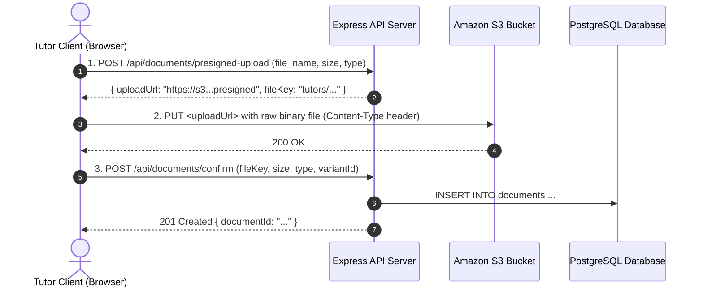

# API Specification — Module 4: Tutor Profile & Verification

> **Base URL:** `http://localhost:4000/api` (local) | `https://api.tutorpair.com/api` (production)
>
> **Authentication:** `Authorization: Bearer <cognito-jwt>`
> Local mock bypass: `Authorization: Bearer mock-token-<user-id>` (see [`AUTH_FLOW.md`](./AUTH_FLOW.md))
>
> **Access Role:** Tutor endpoints require the `TUTOR` role enforced via backend `requireRole(['TUTOR'])` middleware. Catalog reference endpoints (`/api/subjects`) are accessible to all authenticated roles.
>
> **Format Note:** All tutoring sessions and matchmaking are conducted **Online by default**.

---

## How the Backend Identifies the Tutor

Clients **do not** pass a `tutor_id` in the URL or query parameters for self-service tutor endpoints (`/tutors/profile`, `/tutors/subjects`, etc.).

Identity is resolved securely from the authentication token:
1. The frontend sends the Bearer JWT token in the `Authorization` header:
   ```http
   Authorization: Bearer <cognito-access-token>
   ```
2. The `authenticate` middleware validates the token, extracts the authenticated user's Cognito `sub` (or mock ID in dev), and retrieves their record from the PostgreSQL `users` table.
3. The user record is attached to the Express request object as `req.user` (`req.user.id`).
4. The controller and service use `req.user.id` directly to query:
   ```sql
   SELECT * FROM tutors WHERE user_id = req.user.id;
   ```
5. **Security Benefit:** Tutors can never view, overwrite, or tamper with another tutor's profile by manipulating URL parameters.

---

## Response Envelope & Conventions

All API responses strictly implement the [`ApiResponse<T>`](../packages/shared/src/types/index.ts) contract formatted via [`apps/server/src/common/utils/response.util.ts`](../apps/server/src/common/utils/response.util.ts).

### 1. Success Response Structure

```json
{
  "success": true,
  "data": { ... },
  "message": "Optional operation message"
}
```

### 2. Standard Error Response Structure

Error responses are handled centrally by [`errorHandler`](../apps/server/src/common/errors/error-handler.ts) using `AppError` subclasses from [`apps/server/src/common/errors/http-errors.ts`](../apps/server/src/common/errors/http-errors.ts):

```json
{
  "success": false,
  "message": "Human-readable error description",
  "details": null
}
```

**Validation Error Example (`400 Bad Request` / Zod Validation):**

```json
{
  "success": false,
  "message": "Validation failed",
  "details": [
    {
      "field": "phone_number",
      "message": "Phone number is required"
    },
    {
      "field": "style_profile",
      "message": "Style profile requires exactly 5 ratings"
    }
  ]
}
```

### 3. HTTP Status Codes

| Status Code | Error Class | When Used |
|---|---|---|
| `200 OK` | — | Successful query, update, or deletion operation |
| `201 Created` | — | Successful creation (`POST /tutors/profile`, `POST /documents/confirm`) |
| `400 Bad Request` | `BadRequestError` | Request body fails Zod schema validation or time slot bounds |
| `401 Unauthorized` | `UnauthorizedError` | Missing or invalid Cognito JWT bearer token |
| `403 Forbidden` | `ForbiddenError` | Authenticated user is not a `TUTOR` |
| `404 Not Found` | `NotFoundError` | Tutor profile, subject variant, or document does not exist |
| `409 Conflict` | `ConflictError` | Tutor profile already exists for this user |
| `422 Unprocessable Entity` | `UnprocessableEntityError` | Semantically invalid input violating business rules |
| `500 Internal Server Error` | `InternalServerError` | Unhandled server or database exception |

---

## Endpoints Summary

The tutor frontend client (`TutorOnboardingPage`, `TutorProfilePage`, and components) connects to the following endpoints:

| Domain | Method | Endpoint | Description | Frontend Client Use Case |
|---|---|---|---|---|
| **Profile** | `GET` | `/tutors/profile` | Retrieve the authenticated tutor's full profile | Pre-fills onboarding step 1, settings tab, & computes checklist progress |
| **Profile** | `POST` | `/tutors/profile` | Create initial tutor profile & sliders | Step 1 Onboarding submit ("Save Profile & Continue →") |
| **Profile** | `PATCH` | `/tutors/profile` | Update profile information | "Profile & Style" settings tab ("Save Profile Changes") |
| **Subjects** | `GET` | `/tutors/subjects` | List subjects & variants taught by tutor | Displays offerings in Step 2, Settings tab, & requirement proofs in Step 4 |
| **Subjects** | `PUT` | `/tutors/subjects` | Overwrite tutor's offered subjects & rates | Step 2 Onboarding ("Save Subjects & Continue →") & Settings tab |
| **Availability**| `GET` | `/tutors/availability`| Get recurring weekly availability slots | Pre-fills weekly schedule grid in Step 3 & "Weekly Schedule" tab |
| **Availability**| `PUT` | `/tutors/availability`| Overwrite recurring weekly availability schedule | Step 3 Onboarding ("Save Schedule & Continue →") & Settings tab |
| **Verification**| `GET` | `/tutors/verification`| Check verification status & uploaded documents | Pre-fills Step 4 verification checklist & "Verification Docs" tab |
| **Catalog** | `GET` | `/subjects` | Get subjects catalog reference data | Powers 3-step cascading dropdowns in `SubjectSelector` (Category → Subject → Variant) |
| **Documents** | `POST` | `/documents/presigned-upload` | Generate S3 presigned PUT URL | Step 1 of S3 direct upload workflow for transcripts, CVs, and certificates |
| **Documents** | `PUT` | `<presigned-s3-url>` | Upload raw binary document to S3 bucket | Step 2 of S3 direct upload workflow (direct to AWS S3 or mock S3 endpoint) |
| **Documents** | `POST` | `/documents/confirm` | Confirm upload & record metadata in DB | Step 3 of S3 direct upload workflow (creates record in `documents` table) |
| **Documents** | `DELETE`| `/documents/:id` | Delete uploaded document record | Removes incorrect or obsolete certificates in `VerificationSection` |

---

## 1. Personal Profile & Teaching Style

### `GET /tutors/profile`

- **Use Case:**
  - **Onboarding Check:** Determines if Step 1 (Profile & Style) is completed and unlocks progression to Step 2.
  - **Dashboard Checklist:** Displays overall completion progress percentage and welcome header in `TutorProfilePage`.
  - **Form Initialization:** Pre-fills `TutorProfileForm` with personal info, LINE ID, bio, and 5+4 sliders.

**Response `200 OK`**

```json
{
  "success": true,
  "data": {
    "user_id": "8a3d5f30-8041-454d-b636-f0dfbb98305c",
    "first_name": "Somchai",
    "last_name": "Jaidee",
    "phone_number": "0812345678",
    "line_id": "@somchai_tutor",
    "description": "Experienced mathematics and physics tutor with 4 years of exam preparation experience.",
    "tutor_type": "UNDERGRADUATE",
    "style_profile": [4, 5, 3, 4, 2],
    "personality_profile": [5, 4, 4, 3],
    "verification_status": "APPROVED",
    "rejection_reason": null,
    "average_rating": 4.85,
    "review_count": 14
  }
}
```

> **Field Notes:**
> - `line_id`: Optional LINE ID for student-tutor contact upon matchmaking.
> - `tutor_type`: `UNDERGRADUATE` | `FREELANCE` | `INSTITUTIONAL`.
> - `style_profile`: Exactly 5 integers (1 to 5) corresponding to teaching pace, method, interaction, problem style, and structure.
> - `personality_profile`: Exactly 4 integers (1 to 5) corresponding to patience, encouragement, energy, and communication openness.
> - `verification_status`: `PENDING` | `APPROVED` | `REJECTED`.

---

### `POST /tutors/profile`

- **Use Case:**
  - **Step 1 Onboarding Submission:** Invoked when an onboarding tutor completes Personal Information and Sliders and clicks **"Save Profile & Continue →"**.
  - Atomically creates the `tutors` row with identity, contact details, and the 5+4 style/personality profiles.
  - Validated strictly against `TutorProfileSchema`.

**Request Body** (`TutorProfileInput`)

```json
{
  "first_name": "Somchai",
  "last_name": "Jaidee",
  "phone_number": "0812345678",
  "line_id": "@somchai_tutor",
  "description": "Experienced mathematics and physics tutor with 4 years of exam preparation experience.",
  "tutor_type": "UNDERGRADUATE",
  "style_profile": [4, 5, 3, 4, 2],
  "personality_profile": [5, 4, 4, 3]
}
```

**Response `201 Created`**

```json
{
  "success": true,
  "data": {
    "user_id": "8a3d5f30-8041-454d-b636-f0dfbb98305c",
    "first_name": "Somchai",
    "last_name": "Jaidee",
    "phone_number": "0812345678",
    "line_id": "@somchai_tutor",
    "description": "Experienced mathematics and physics tutor with 4 years of exam preparation experience.",
    "tutor_type": "UNDERGRADUATE",
    "style_profile": [4, 5, 3, 4, 2],
    "personality_profile": [5, 4, 4, 3],
    "verification_status": "PENDING",
    "rejection_reason": null,
    "average_rating": 0.00,
    "review_count": 0
  },
  "message": "Tutor profile created successfully"
}
```

---

### `PATCH /tutors/profile`

- **Use Case:**
  - **Edit Profile:** Invoked when an existing tutor updates specific profile fields (e.g., updating phone number, LINE ID, bio description, or readjusting slider ratings) from the "Profile & Style" tab.
  - Validated against `UpdateTutorProfileSchema` (all fields optional).

**Request Body** (`UpdateTutorProfileInput` — any subset of fields)

```json
{
  "line_id": "@somchai_new",
  "description": "Updated bio: Specializing in intensive exam workshops and online problem sessions.",
  "style_profile": [5, 5, 4, 4, 3]
}
```

**Response `200 OK`**

```json
{
  "success": true,
  "data": {
    "user_id": "8a3d5f30-8041-454d-b636-f0dfbb98305c",
    "first_name": "Somchai",
    "last_name": "Jaidee",
    "phone_number": "0812345678",
    "line_id": "@somchai_new",
    "description": "Updated bio: Specializing in intensive exam workshops and online problem sessions.",
    "tutor_type": "UNDERGRADUATE",
    "style_profile": [5, 5, 4, 4, 3],
    "personality_profile": [5, 4, 4, 3],
    "verification_status": "APPROVED",
    "rejection_reason": null,
    "average_rating": 4.85,
    "review_count": 14
  },
  "message": "Tutor profile updated successfully"
}
```

---

## 2. Subjects & Rates

> **Pricing Architecture Note:** Hourly rate is configured **per subject offering** in `tutor_subjects` rather than as a global flat rate. A tutor can charge 500 THB/hr for General Math and 800 THB/hr for Digital SAT Math.

### `GET /tutors/subjects`

- **Use Case:**
  - **Subject Offerings Display:** Fetches all subjects and variants taught by the tutor, with their custom hourly rate, targeted grade levels, and teaching focus tags.
  - Used in Step 2 of onboarding, in the "Subjects & Rates" dashboard tab, and by Step 4 to determine which variants have `requires_proof = true`.

**Response `200 OK`**

```json
{
  "success": true,
  "data": {
    "subjects": [
      {
        "variant_id": "4b5d6e7f-8a9b-0c1d-2e3f-4a5b6c7d8e9f",
        "subject_id": "1a2b3c4d-5e6f-7a8b-9c0d-1e2f3a4b5c6d",
        "subject_name": "Mathematics",
        "variant_name": "Primary & Lower Secondary Math",
        "category": "GENERAL_LEARNING",
        "learning_goal": "SCHOOL_CURRICULUM",
        "requires_proof": false,
        "hourly_rate": 500.00,
        "grade_levels": ["G7", "G8", "G9"],
        "teaching_focus": "Curriculum strengthening and homework assistance"
      },
      {
        "variant_id": "7c8d9e0f-1a2b-3c4d-5e6f-7a8b9c0d1e2f",
        "subject_id": "1a2b3c4d-5e6f-7a8b-9c0d-1e2f3a4b5c6d",
        "subject_name": "Mathematics",
        "variant_name": "A-Level Applied Math 1",
        "category": "UNIVERSITY_ENTRANCE",
        "learning_goal": "A_LEVEL",
        "requires_proof": true,
        "hourly_rate": 750.00,
        "grade_levels": ["G12"],
        "teaching_focus": "Intensive mock testing and speed problem solving"
      }
    ]
  }
}
```

---

### `PUT /tutors/subjects`

- **Use Case:**
  - **Save Subjects Offering:** Invoked in Step 2 of onboarding (**"Save Subjects & Continue →"**) and in the "Subjects & Rates" management tab (**"Save Subject Offerings"**).
  - Performs an atomic replacement of the tutor's offerings in `tutor_subjects`.
  - Validated against `SetTutorSubjectsSchema`. Every subject item must include a valid `variant_id` and positive `hourly_rate`.

**Request Body** (`SetTutorSubjectsInput`)

```json
{
  "subjects": [
    {
      "variant_id": "4b5d6e7f-8a9b-0c1d-2e3f-4a5b6c7d8e9f",
      "hourly_rate": 500.00,
      "grade_levels": ["G7", "G8", "G9"],
      "teaching_focus": "Curriculum strengthening and homework assistance"
    },
    {
      "variant_id": "7c8d9e0f-1a2b-3c4d-5e6f-7a8b9c0d1e2f",
      "hourly_rate": 750.00,
      "grade_levels": ["G12"],
      "teaching_focus": "Intensive mock testing and speed problem solving"
    }
  ]
}
```

**Response `200 OK`**

```json
{
  "success": true,
  "data": {
    "subjects": [
      {
        "variant_id": "4b5d6e7f-8a9b-0c1d-2e3f-4a5b6c7d8e9f",
        "subject_id": "1a2b3c4d-5e6f-7a8b-9c0d-1e2f3a4b5c6d",
        "subject_name": "Mathematics",
        "variant_name": "Primary & Lower Secondary Math",
        "category": "GENERAL_LEARNING",
        "learning_goal": "SCHOOL_CURRICULUM",
        "requires_proof": false,
        "hourly_rate": 500.00,
        "grade_levels": ["G7", "G8", "G9"],
        "teaching_focus": "Curriculum strengthening and homework assistance"
      },
      {
        "variant_id": "7c8d9e0f-1a2b-3c4d-5e6f-7a8b9c0d1e2f",
        "subject_id": "1a2b3c4d-5e6f-7a8b-9c0d-1e2f3a4b5c6d",
        "subject_name": "Mathematics",
        "variant_name": "A-Level Applied Math 1",
        "category": "UNIVERSITY_ENTRANCE",
        "learning_goal": "A_LEVEL",
        "requires_proof": true,
        "hourly_rate": 750.00,
        "grade_levels": ["G12"],
        "teaching_focus": "Intensive mock testing and speed problem solving"
      }
    ]
  },
  "message": "Tutor subjects updated successfully"
}
```

---

## 3. Availability & Schedule

### `GET /tutors/availability`

- **Use Case:**
  - **Schedule Loading:** Loads the tutor's recurring weekly availability time windows.
  - Used in Step 3 of onboarding, in the "Weekly Schedule" tab, and on the dashboard checklist.

**Response `200 OK`**

```json
{
  "success": true,
  "data": {
    "availability": [
      {
        "id": "9f8e7d6c-5b4a-3f2e-1d0c-9b8a7f6e5d4c",
        "day_of_week": "MONDAY",
        "start_time": "17:00:00",
        "end_time": "20:00:00"
      },
      {
        "id": "1b2c3d4e-5f6a-7b8c-9d0e-1f2a3b4c5d6e",
        "day_of_week": "SATURDAY",
        "start_time": "09:00:00",
        "end_time": "12:00:00"
      }
    ]
  }
}
```

> **Field Notes:**
> - `day_of_week`: `MONDAY` | `TUESDAY` | `WEDNESDAY` | `THURSDAY` | `FRIDAY` | `SATURDAY` | `SUNDAY`
> - `start_time` / `end_time`: 24-hour time format string `HH:mm` or `HH:mm:ss`.

---

### `PUT /tutors/availability`

- **Use Case:**
  - **Save Availability Schedule:** Invoked in Step 3 of onboarding (**"Save Schedule & Continue →"**) and in the "Weekly Schedule" tab (**"Save Availability Changes"**).
  - Replaces all recurring availability records for `req.user.id` in `availabilities`.
  - Backend verifies that `start_time < end_time` for each slot and prevents duplicate/overlapping slots on the same day.

**Request Body** (`SetTutorAvailabilityInput`)

```json
{
  "availability": [
    {
      "day_of_week": "MONDAY",
      "start_time": "17:00",
      "end_time": "20:00"
    },
    {
      "day_of_week": "WEDNESDAY",
      "start_time": "17:00",
      "end_time": "20:00"
    },
    {
      "day_of_week": "SATURDAY",
      "start_time": "09:00",
      "end_time": "16:00"
    }
  ]
}
```

**Response `200 OK`**

```json
{
  "success": true,
  "data": {
    "availability": [
      {
        "id": "d0e1f2a3-b4c5-6d7e-8f9a-0b1c2d3e4f5a",
        "day_of_week": "MONDAY",
        "start_time": "17:00:00",
        "end_time": "20:00:00"
      },
      {
        "id": "e1f2a3b4-c56d-7e8f-9a0b-1c2d3e4f5a6b",
        "day_of_week": "WEDNESDAY",
        "start_time": "17:00:00",
        "end_time": "20:00:00"
      },
      {
        "id": "f2a3b4c5-6d7e-8f9a-0b1c-2d3e4f5a6b7c",
        "day_of_week": "SATURDAY",
        "start_time": "09:00:00",
        "end_time": "16:00:00"
      }
    ]
  },
  "message": "Availability schedule updated successfully"
}
```

---

## 4. Verification Status & Documents

### `GET /tutors/verification`

- **Use Case:**
  - **Verification Status Tracking:** Allows the tutor to inspect their verification status (`PENDING`, `APPROVED`, `REJECTED`), check administrator rejection reason feedback, and view the list of files currently attached.
  - Used in Step 4 of onboarding, in the "Verification Docs" tab, and on the dashboard header.

**Response `200 OK`**

```json
{
  "success": true,
  "data": {
    "verification_status": "PENDING",
    "rejection_reason": null,
    "documents": [
      {
        "id": "5a6b7c8d-9e0f-1a2b-3c4d-5e6f7a8b9c0d",
        "document_type": "DEGREE_TRANSCRIPT",
        "file_key": "tutors/8a3d5f30-8041-454d-b636-f0dfbb98305c/degree_transcript.pdf",
        "file_size_kb": 1420,
        "variant_id": null,
        "uploaded_at": "2024-01-15T08:30:00Z"
      },
      {
        "id": "7b8c9d0e-1f2a-3b4c-5d6e-7f8a9b0c1d2e",
        "document_type": "CV",
        "file_key": "tutors/8a3d5f30-8041-454d-b636-f0dfbb98305c/cv_resume.pdf",
        "file_size_kb": 920,
        "variant_id": null,
        "uploaded_at": "2024-01-15T08:32:00Z"
      },
      {
        "id": "6b7c8d9e-0f1a-2b3c-4d5e-6f7a8b9c0d1e",
        "document_type": "SUBJECT_QUALIFICATION",
        "file_key": "tutors/8a3d5f30-8041-454d-b636-f0dfbb98305c/alevel_score.pdf",
        "file_size_kb": 850,
        "variant_id": "7c8d9e0f-1a2b-3c4d-5e6f-7a8b9c0d1e2f",
        "uploaded_at": "2024-01-15T08:35:00Z"
      }
    ]
  }
}
```

> **Field Notes:**
> - `document_type`: `DEGREE_TRANSCRIPT` | `CV` | `SUBJECT_QUALIFICATION`
> - `variant_id`: Null for general credentials (Degree, CV, Supporting Certificates); UUID when attached to a specific standardized subject variant requiring proof.

---

## 5. Subjects Reference Catalog

### `GET /subjects`

- **Use Case:**
  - **Cascading Subject Selector:** Powers the 3-step cascading subject selector in `SubjectSelector.tsx` (Step 2 Onboarding & Subjects Settings tab).
  - Tutors select a **Category** (`GENERAL_LEARNING`, `LANGUAGE_TESTING`, `UNIVERSITY_ENTRANCE`), which filters the **Subjects** (e.g. Mathematics, Digital SAT), which reveals available **Variants** (e.g. A-Level Math, School Curriculum Math) along with `learning_goal` and `requires_proof` flag.
  - Optional query parameter: `?category=LANGUAGE_TESTING`.

**Response `200 OK`**

```json
{
  "success": true,
  "data": [
    {
      "id": "1a2b3c4d-5e6f-7a8b-9c0d-1e2f3a4b5c6d",
      "name": "Mathematics",
      "category": "GENERAL_LEARNING",
      "variants": [
        {
          "id": "4b5d6e7f-8a9b-0c1d-2e3f-4a5b6c7d8e9f",
          "name": "Primary & Lower Secondary Math",
          "learning_goal": "SCHOOL_CURRICULUM",
          "requires_proof": false
        },
        {
          "id": "92591e2d-9986-43ff-9cbd-0a9f657595fa",
          "name": "Upper Secondary Math (G10–G12)",
          "learning_goal": "SCHOOL_CURRICULUM",
          "requires_proof": false
        }
      ]
    },
    {
      "id": "2b3c4d5e-6f7a-8b9c-0d1e-2f3a4b5c6d7e",
      "name": "Digital SAT",
      "category": "UNIVERSITY_ENTRANCE",
      "variants": [
        {
          "id": "ee1f996b-c944-4c1e-b024-2d008eb5d810",
          "name": "Digital SAT Math (700+)",
          "learning_goal": "STANDARDIZED_EXAMS",
          "requires_proof": true
        }
      ]
    }
  ]
}
```

---

## 6. S3 Direct Document Upload Workflow

All file uploads follow the **3-step Presigned URL pattern** (no file streaming through backend application servers) detailed in [`S3_DOCUMENTS.md`](./S3_DOCUMENTS.md):



### `POST /documents/presigned-upload`

- **Use Case:**
  - **Step 1 of Document Upload:** Generates a short-lived presigned PUT URL allowing the browser to upload the file directly to the S3 bucket.
  - Maximum allowed file size is 10 MB (`10240 KB`).
  - Supported formats: `.pdf`, `.png`, `.jpg`, `.jpeg`.

**Request Body** (`PresignedUploadRequestInput`)

```json
{
  "file_name": "chula_degree_transcript.pdf",
  "file_size_kb": 1420,
  "document_type": "DEGREE_TRANSCRIPT",
  "variant_id": null
}
```

**Response `200 OK`**

```json
{
  "success": true,
  "data": {
    "uploadUrl": "https://tutorpair-docs-dev.s3.ap-southeast-1.amazonaws.com/tutors/8a3d5f30-8041-454d-b636-f0dfbb98305c/degree_transcript.pdf?X-Amz-Algorithm=AWS4-HMAC-SHA256&X-Amz-Credential=...",
    "fileKey": "tutors/8a3d5f30-8041-454d-b636-f0dfbb98305c/degree_transcript.pdf"
  },
  "message": "Presigned upload URL generated successfully"
}
```

---

### `PUT <uploadUrl>` (Direct S3 Binary Upload)

- **Use Case:**
  - **Step 2 of Document Upload:** Browser issues a direct HTTP `PUT` request with the file blob to the presigned S3 URL.
  - In local development mode without AWS credentials, requests are routed to `/api/documents/mock-s3-upload/*` which immediately returns `200 OK`.
- **Headers:**
  - `Content-Type: application/pdf` (or `image/png`, `image/jpeg`).
- **Body:** Binary file payload.

---

### `POST /documents/confirm`

- **Use Case:**
  - **Step 3 of Document Upload:** Invoked once S3 returns HTTP 200 to confirm that the file landed in S3.
  - Records the document in the PostgreSQL `documents` table and links it to the tutor's user ID.

**Request Body** (`ConfirmUploadInput`)

```json
{
  "file_key": "tutors/8a3d5f30-8041-454d-b636-f0dfbb98305c/degree_transcript.pdf",
  "file_size_kb": 1420,
  "document_type": "DEGREE_TRANSCRIPT",
  "variant_id": null
}
```

**Response `201 Created`**

```json
{
  "success": true,
  "data": {
    "documentId": "5a6b7c8d-9e0f-1a2b-3c4d-5e6f7a8b9c0d"
  },
  "message": "Document confirmed and saved"
}
```

---

### `DELETE /documents/:id`

- **Use Case:**
  - **Delete Uploaded Document:** Allows tutors to remove a previously uploaded document (e.g. if the administrator requested a clearer image during rejection review, or to replace an expired certificate).
  - Validates that the document belongs to `req.user.id` and removes the record from PostgreSQL.

**Response `200 OK`**

```json
{
  "success": true,
  "data": null,
  "message": "Document deleted successfully"
}
```
