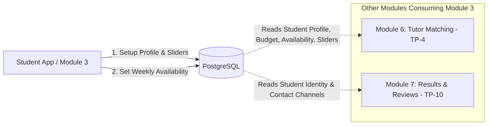
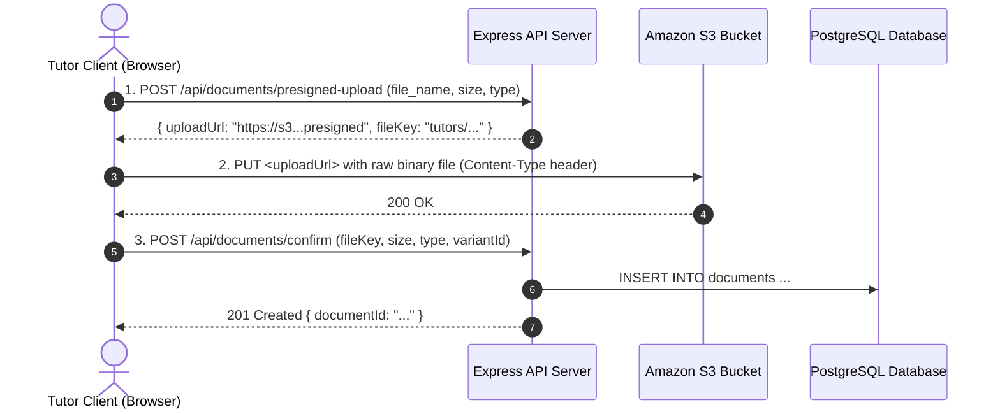

# TutorPair API Specification

> **Base URL:** `http://localhost:4000/api` (local) | `https://api.tutorpair.com/api` (production)
>
> **Authentication:** `Authorization: Bearer <cognito-jwt>`  
> Local mock bypass: `Authorization: Bearer mock-token-<user-id>` (see [`AUTH_FLOW.md`](./AUTH_FLOW.md))
>
> **Conventions:**
> - All tutoring sessions and matchmaking are conducted **Online by default**.
> - Clients **never** pass `user_id`, `student_id`, or `tutor_id` in URLs for self-service endpoints. Identity is securely resolved from `req.user.id` via JWT.
> - All responses conform strictly to [`ApiResponse<T>`](../packages/shared/src/types/index.ts).

---

## Response Envelope & Conventions

All API responses strictly implement [`ApiResponse<T>`](../packages/shared/src/types/index.ts) formatted via [`apps/server/src/common/utils/response.util.ts`](../apps/server/src/common/utils/response.util.ts).

### 1. Success Response Structure

```json
{
  "success": true,
  "data": { ... },
  "message": "Optional operation message"
}
```

### 2. Standard Error Response Structure

Error responses are handled centrally by [`errorHandler`](../apps/server/src/common/errors/error-handler.ts) using `AppError` subclasses from [`apps/server/src/common/errors/http-errors.ts`](../apps/server/src/common/errors/http-errors.ts):

```json
{
  "success": false,
  "message": "Human-readable error description",
  "details": null
}
```

**Validation Error Example (`400 Bad Request` / Zod Validation):**

```json
{
  "success": false,
  "message": "Request validation failed",
  "details": [
    {
      "field": "phone_number",
      "message": "Phone number is required"
    },
    {
      "field": "style_profile",
      "message": "Style profile requires exactly 5 ratings"
    }
  ]
}
```

### 3. HTTP Status Codes

| Status Code | Error Class | When Used |
|---|---|---|
| `200 OK` | — | Successful query, update, or deletion operation |
| `201 Created` | — | Successful creation (`POST /students/profile`, `POST /tutors/profile`, `POST /documents/confirm`) |
| `400 Bad Request` | `BadRequestError` | Request body or params fail Zod schema validation, invalid UUID, malformed JSON, or invalid time slot bounds |
| `401 Unauthorized` | `UnauthorizedError` | Missing, expired, or invalid Cognito JWT bearer token |
| `403 Forbidden` | `ForbiddenError` | Authenticated user lacks required role or tries to access another user's private resource |
| `404 Not Found` | `NotFoundError` | Tutor profile, subject variant, document, or route does not exist |
| `409 Conflict` | `ConflictError` | Tutor profile already exists for this user, or schedule contains overlapping slots on the same day |
| `422 Unprocessable Entity` | `UnprocessableEntityError` | Semantically invalid input violating business rules |
| `500 Internal Server Error` | `InternalServerError` | Unhandled server or database exception |

---

# Part 1: Module 3 — Student Profile & Preferences

> **Jira Epic:** TP-50: Development — Student Profile & Preferences  
> **Sub-Tasks:**  
> • **TP-58**: Develop student profile functionality  
> • **TP-57**: Develop student learning preference functionality (1–5 Sliders)  
> • **TP-54**: Develop student availability and requirement (Budget, Tutor Type & Time Slots)  
>
> **Access Role:** Student endpoints require the `STUDENT` role enforced via backend `requireRole(['STUDENT'])` middleware.

## 1. Executive Summary & Cross-Module Context

Module 3 handles everything related to the student's personal identity, contact information, academic level, pedagogical learning preferences (via 1–5 sliders), budget constraints, and recurring weekly schedule availability.



### How Other Modules Connect to Module 3:

1. **Module 6 — Tutor Matching (`TP-4`)**:
   * When a student submits a matching request, the matching engine extracts the student's baseline preferences from Module 3:
     * **Hard Filters**: Student's `grade_level` (G1–G12) and weekly `availabilities` (day of week + time range overlap).
     * **Scoring Dimensions**: Student's `style_profile` (5 sliders), `personality_profile` (4 sliders), `budget_max`, and `tutor_type_pref`.
   * *Cross-Module Rule*: Module 6's service must import `studentsRepository` directly (never `studentsService`). Module 3 exposes:
     ```typescript
     studentsRepository.getProfileWithAvailability(studentId: string): Promise<StudentWithAvailabilityDto | null>
     ```

2. **Module 7 — Matching Results, History & Reviews (`TP-10`)**:
   * When a tutor is confirmed, the confirmed tutor receives the student's contact channels (`phone_number`, `line_id`, `first_name`, `last_name`).
   * Review gating checks verify that the user submitting the review is a `STUDENT` who confirmed a lesson with that tutor.

---

## 2. Authentication & Identity Resolution

Clients **never** pass a `student_id` in route paths or request bodies for self-service endpoints (`/students/profile`, `/students/availability`).

1. Frontend sends Bearer JWT in the HTTP header:
   ```http
   Authorization: Bearer <token>
   ```
2. The `authenticate` middleware verifies the token and attaches `req.user` (`req.user.id`, `req.user.role`).
3. The `requireRole(['STUDENT'])` middleware ensures only authenticated students can access these endpoints.
4. The service/repository queries:
   ```sql
   SELECT * FROM students WHERE user_id = req.user.id;
   ```
5. **Security Guarantee:** Students cannot inspect, modify, or overwrite another student's profile.

---

## 3. Response Envelope & Global Error Handling Template

All API responses strictly implement [`ApiResponse<T>`](../packages/shared/src/types/index.ts) formatted centrally via [`apps/server/src/common/utils/response.util.ts`](../apps/server/src/common/utils/response.util.ts).

### 3.1. Success Response Structure (`200 OK`, `201 Created`)

```json
{
  "success": true,
  "data": { ... },
  "message": "Operation completed successfully"
}
```

### 3.2. Global Error Response Structure

Error responses are caught and formatted centrally by [`errorHandler`](../apps/server/src/common/errors/error-handler.ts) using typed `AppError` subclasses from [`apps/server/src/common/errors/http-errors.ts`](../apps/server/src/common/errors/http-errors.ts):

```json
{
  "success": false,
  "message": "Human-readable error description",
  "details": null
}
```

#### Request Validation Error Example (`400 Bad Request` / Zod Validation):
When incoming payload fails type checking or boundary validation via `validateRequest(Schema)`:

```json
{
  "success": false,
  "message": "Request validation failed",
  "details": [
    {
      "field": "phone_number",
      "message": "Phone number is required"
    },
    {
      "field": "grade_level",
      "message": "Grade level must be between G1 and G12 (e.g. G10)"
    },
    {
      "field": "style_profile",
      "message": "Style profile requires exactly 5 ratings"
    }
  ]
}
```

### 3.3. HTTP Status Codes Reference

| Status Code | Error Class | When Used in Module 3 |
|---|---|---|
| `200 OK` | — | Successful retrieval (`GET /students/profile`, `GET /students/availability`, `GET /students/subjects`), update (`PATCH /students/profile`), or atomic replacement (`PUT /students/availability`, `PUT /students/subjects`) |
| `201 Created` | — | Successful creation of initial student profile (`POST /students/profile`) |
| `400 Bad Request` | `BadRequestError` | Zod schema validation failed, missing required fields, `grade_level` not matching G1–G12, slider ratings out of 1–5 range, `budget_max <= 0`, `start_time >= end_time`, overlapping availability slots on the same day, duplicate subject variants, or empty update payload |
| `401 Unauthorized` | `UnauthorizedError` | Missing, expired, or malformed Cognito JWT (`Authorization: Bearer <token>`) or missing user record |
| `403 Forbidden` | `ForbiddenError` | Authenticated user lacks `STUDENT` role (e.g., tutor or admin attempting to modify student profile) |
| `404 Not Found` | `NotFoundError` | Student profile does not exist for the authenticated user, or referenced `variant_id` does not exist in `subject_variants` |
| `409 Conflict` | `ConflictError` | Student profile already exists for this user on `POST /students/profile` |
| `422 Unprocessable Entity` | `UnprocessableEntityError` | Semantically invalid payload violating business logic rules |
| `500 Internal Server Error` | `InternalServerError` | Unhandled server or database exception (sanitized in production) |

---

## 4. Endpoints Summary

| Sub-Task | Method | Endpoint | Description | Frontend Client Use Case |
|---|---|---|---|---|
| **TP-58 / TP-57 / TP-54** | `GET` | `/students/profile` *(alias: `/students/me/profile`)* | Retrieve student profile, preferences & budget | Pre-fills `StudentProfilePage` and matching pre-checks |
| **TP-58 / TP-57 / TP-54** | `POST` | `/students/profile` | Create initial student profile & sliders | First-time onboarding / profile completion |
| **TP-58 / TP-57 / TP-54** | `PATCH` | `/students/profile` *(alias: `/students/me/profile`)* | Partially update student profile or preferences | Profile settings update & quick slider adjustments |
| **TP-54** | `GET` | `/students/availability` | Get recurring weekly availability slots | Populates student availability grid |
| **TP-54** | `PUT` | `/students/availability` | Overwrite recurring weekly availability slots | Saves weekly student schedule for matching overlap |
| **TP-58** | `GET` | `/students/subjects` | Get selected target subjects & variants | Populates student subject requirement selector |
| **TP-58** | `PUT` | `/students/subjects` | Overwrite selected target subject variants | Saves student subject requirements for matching |

---

## 5. Detailed Endpoint Specifications

### 5.1. `GET /api/students/profile` (TP-58, TP-57, TP-54)

Retrieves the authenticated student's profile, contact channels, grade level, 1–5 learning/personality preferences, and budget.

* **Endpoints:** `GET /api/students/profile` *(Alias: `GET /api/students/me/profile`)*
* **Headers:** `Authorization: Bearer <token>`
* **Role:** `STUDENT`

#### Response `200 OK`
```json
{
  "success": true,
  "data": {
    "user_id": "9b1deb4d-3b7d-4bad-9bdd-2b0d7b3dcb6d",
    "email": "student@example.com",
    "first_name": "Pitchaya",
    "last_name": "Siriwong",
    "phone_number": "0891234567",
    "line_id": "pitchaya.s",
    "grade_level": "G10",
    "tutor_type_pref": "ANY",
    "style_profile": [3, 4, 2, 4, 3],
    "personality_profile": [4, 5, 3, 4],
    "budget_max": 650.00
  }
}
```

> **Note on `email`:** Extracted from the authenticated session (`users` table) for display as a readonly field.

#### Error Responses

##### `401 Unauthorized`
*(Returned when Authorization header is missing, token is expired, or user is unauthenticated)*
```json
{
  "success": false,
  "message": "Missing or malformed Authorization header",
  "details": null
}
```

##### `403 Forbidden`
*(Returned when authenticated user has a role other than `STUDENT`)*
```json
{
  "success": false,
  "message": "Access denied. Required role: [STUDENT], Current role: TUTOR",
  "details": null
}
```

##### `404 Not Found`
*(Returned when user is authenticated with `STUDENT` role but has not yet completed the initial profile)*
```json
{
  "success": false,
  "message": "Student profile not found",
  "details": null
}
```

##### `500 Internal Server Error`
*(Returned when database connectivity fails or an unexpected operational error occurs)*
```json
{
  "success": false,
  "message": "Internal Server Error",
  "details": null
}
```

---

### 5.2. `POST /api/students/profile` (TP-58, TP-57, TP-54)

Creates the student profile record upon initial registration/onboarding.

* **Headers:** `Authorization: Bearer <token>`
* **Role:** `STUDENT`
* **Validation Schema:** `StudentProfileSchema`

#### Request Body
```json
{
  "first_name": "Pitchaya",
  "last_name": "Siriwong",
  "phone_number": "0891234567",
  "line_id": "pitchaya.s",
  "grade_level": "G10",
  "tutor_type_pref": "ANY",
  "style_profile": [3, 4, 2, 4, 3],
  "personality_profile": [4, 5, 3, 4],
  "budget_max": 650.00
}
```

#### Field Validation Rules:
* `first_name`: Required string, 1–100 chars. Leading/trailing whitespace trimmed.
* `last_name`: Required string, 1–100 chars. Leading/trailing whitespace trimmed.
* `phone_number`: Required string, 1–20 chars. Valid Thai mobile format recommended (`08...`, `09...`, `06...`).
* `line_id`: Optional string, max 100 chars (or `null`).
* `grade_level`: Required string matching G1–G12 (`'G1'` through `'G12'`).
* `tutor_type_pref`: Enum value from `TutorTypePref`: `'UNDERGRADUATE'`, `'FREELANCE'`, `'INSTITUTIONAL'`, or `'ANY'`.
* `style_profile`: Exactly 5 integer ratings, each between 1 and 5.
* `personality_profile`: Exactly 4 integer ratings, each between 1 and 5.
* `budget_max`: Positive number $> 0$ (maximum hourly rate in THB).

#### Response `201 Created`
```json
{
  "success": true,
  "data": {
    "user_id": "9b1deb4d-3b7d-4bad-9bdd-2b0d7b3dcb6d",
    "first_name": "Pitchaya",
    "last_name": "Siriwong",
    "phone_number": "0891234567",
    "line_id": "pitchaya.s",
    "grade_level": "G10",
    "tutor_type_pref": "ANY",
    "style_profile": [3, 4, 2, 4, 3],
    "personality_profile": [4, 5, 3, 4],
    "budget_max": 650.00
  },
  "message": "Student profile created successfully"
}
```

#### Error Responses

##### `400 Bad Request`
*(Returned when request payload violates Zod schema constraints or business rules)*
```json
{
  "success": false,
  "message": "Request validation failed",
  "details": [
    {
      "field": "grade_level",
      "message": "Grade level must be between G1 and G12 (e.g. G10)"
    },
    {
      "field": "style_profile",
      "message": "Style profile requires exactly 5 ratings"
    },
    {
      "field": "budget_max",
      "message": "Budget must be greater than 0"
    }
  ]
}
```

##### `401 Unauthorized`
*(Returned when Authorization header is missing, token is expired, or user is unauthenticated)*
```json
{
  "success": false,
  "message": "Missing or malformed Authorization header",
  "details": null
}
```

##### `403 Forbidden`
*(Returned when authenticated user is not in `STUDENT` role)*
```json
{
  "success": false,
  "message": "Access denied. Required role: [STUDENT], Current role: TUTOR",
  "details": null
}
```

##### `409 Conflict`
*(Returned if student profile already exists for this authenticated user)*
```json
{
  "success": false,
  "message": "Student profile already exists for this user",
  "details": null
}
```

##### `500 Internal Server Error`
*(Returned when database insertion fails or unhandled operational exception occurs)*
```json
{
  "success": false,
  "message": "Internal Server Error",
  "details": null
}
```

---

### 5.3. `PATCH /api/students/profile` (TP-58, TP-57, TP-54)

Updates any subset of profile fields, contact info, sliders, or budget.

* **Endpoints:** `PATCH /api/students/profile` *(Alias: `PATCH /api/students/me/profile`)*
* **Headers:** `Authorization: Bearer <token>`
* **Role:** `STUDENT`
* **Validation Schema:** `UpdateStudentProfileSchema` (requires at least one valid field to update)

#### Request Body (Example: Updating contact and budget only)
```json
{
  "phone_number": "0819998888",
  "budget_max": 750.00
}
```

#### Request Body (Example: Updating slider ratings)
```json
{
  "style_profile": [4, 4, 3, 5, 3],
  "personality_profile": [5, 5, 4, 4]
}
```

#### Response `200 OK`
```json
{
  "success": true,
  "data": {
    "user_id": "9b1deb4d-3b7d-4bad-9bdd-2b0d7b3dcb6d",
    "first_name": "Pitchaya",
    "last_name": "Siriwong",
    "phone_number": "0819998888",
    "line_id": "pitchaya.s",
    "grade_level": "G10",
    "tutor_type_pref": "ANY",
    "style_profile": [4, 4, 3, 5, 3],
    "personality_profile": [5, 5, 4, 4],
    "budget_max": 750.00
  },
  "message": "Student profile updated successfully"
}
```

#### Error Responses

##### `400 Bad Request`
*(Returned when request body is empty, contains invalid slider ratings, negative budget, or invalid grade level)*
```json
{
  "success": false,
  "message": "At least one field must be provided to update profile",
  "details": null
}
```

##### `401 Unauthorized`
*(Returned when Authorization header is missing, token is expired, or user is unauthenticated)*
```json
{
  "success": false,
  "message": "Missing or malformed Authorization header",
  "details": null
}
```

##### `403 Forbidden`
*(Returned when authenticated user is not in `STUDENT` role)*
```json
{
  "success": false,
  "message": "Access denied. Required role: [STUDENT], Current role: TUTOR",
  "details": null
}
```

##### `404 Not Found`
*(Returned when student profile does not exist for this user)*
```json
{
  "success": false,
  "message": "Student profile not found",
  "details": null
}
```

##### `500 Internal Server Error`
*(Returned when database update fails or unhandled operational exception occurs)*
```json
{
  "success": false,
  "message": "Internal Server Error",
  "details": null
}
```

---

### 5.4. `GET /api/students/availability` (TP-54)

Retrieves the student's recurring weekly availability time slots.

* **Headers:** `Authorization: Bearer <token>`
* **Role:** `STUDENT`

#### Response `200 OK`
```json
{
  "success": true,
  "data": [
    {
      "id": "1a2b3c4d-0001-4000-8000-111122223333",
      "day_of_week": "MONDAY",
      "start_time": "17:00",
      "end_time": "19:00"
    },
    {
      "id": "1a2b3c4d-0002-4000-8000-111122223333",
      "day_of_week": "SATURDAY",
      "start_time": "10:00",
      "end_time": "12:00"
    }
  ]
}
```

#### Error Responses

##### `401 Unauthorized`
*(Returned when Authorization header is missing, token is expired, or user is unauthenticated)*
```json
{
  "success": false,
  "message": "Missing or malformed Authorization header",
  "details": null
}
```

##### `403 Forbidden`
*(Returned when authenticated user is not in `STUDENT` role)*
```json
{
  "success": false,
  "message": "Access denied. Required role: [STUDENT], Current role: TUTOR",
  "details": null
}
```

##### `404 Not Found`
*(Returned when student profile does not exist for this user)*
```json
{
  "success": false,
  "message": "Student profile not found",
  "details": null
}
```

##### `500 Internal Server Error`
*(Returned when query execution fails)*
```json
{
  "success": false,
  "message": "Internal Server Error",
  "details": null
}
```

---

### 5.5. `PUT /api/students/availability` (TP-54)

Overwrites the student's recurring weekly availability time slots. Existing slots for this user are replaced atomically in a single database transaction.

* **Headers:** `Authorization: Bearer <token>`
* **Role:** `STUDENT`
* **Validation Schema:** `SetStudentAvailabilitySchema` (accepts `{ "availability": [...] }` as primary, with `{ "slots": [...] }` supported as a backwards-compatible alias)

#### Request Body
```json
{
  "availability": [
    {
      "day_of_week": "MONDAY",
      "start_time": "17:00",
      "end_time": "19:00"
    },
    {
      "day_of_week": "WEDNESDAY",
      "start_time": "17:00",
      "end_time": "19:00"
    },
    {
      "day_of_week": "SATURDAY",
      "start_time": "09:00",
      "end_time": "12:00"
    }
  ]
}
```

#### Validation Rules:
* `day_of_week`: `MONDAY` | `TUESDAY` | `WEDNESDAY` | `THURSDAY` | `FRIDAY` | `SATURDAY` | `SUNDAY`
* `start_time`, `end_time`: 24-hour format `HH:mm` (e.g., `"17:00"`).
* `start_time` must be strictly earlier than `end_time`.
* Slots on the same day must not overlap.

#### Response `200 OK`
```json
{
  "success": true,
  "data": [
    {
      "id": "3a1b2c4d-0001-4000-8000-111122223333",
      "day_of_week": "MONDAY",
      "start_time": "17:00",
      "end_time": "19:00"
    },
    {
      "id": "3a1b2c4d-0002-4000-8000-111122223333",
      "day_of_week": "WEDNESDAY",
      "start_time": "17:00",
      "end_time": "19:00"
    },
    {
      "id": "3a1b2c4d-0003-4000-8000-111122223333",
      "day_of_week": "SATURDAY",
      "start_time": "09:00",
      "end_time": "12:00"
    }
  ],
  "message": "Availability schedule updated successfully"
}
```

#### Error Responses

##### `400 Bad Request`
*(Returned when slot timing is invalid or slots overlap on the same day)*
```json
{
  "success": false,
  "message": "Overlapping availability slots detected for MONDAY: (17:00-19:00) and (18:00-20:00)",
  "details": null
}
```
*(Or when time bounds fail: `Invalid time slot for MONDAY: start_time (19:00) must be earlier than end_time (17:00)`)*

##### `401 Unauthorized`
*(Returned when Authorization header is missing, token is expired, or user is unauthenticated)*
```json
{
  "success": false,
  "message": "Missing or malformed Authorization header",
  "details": null
}
```

##### `403 Forbidden`
*(Returned when authenticated user is not in `STUDENT` role)*
```json
{
  "success": false,
  "message": "Access denied. Required role: [STUDENT], Current role: TUTOR",
  "details": null
}
```

##### `404 Not Found`
*(Returned when student profile does not exist for this user)*
```json
{
  "success": false,
  "message": "Student profile not found",
  "details": null
}
```

##### `500 Internal Server Error`
*(Returned when database transaction replacement fails)*
```json
{
  "success": false,
  "message": "Internal Server Error",
  "details": null
}
```

---

### 5.6. `GET /api/students/subjects` (TP-58)

Retrieves the student's selected target subjects with category and learning goal details.

* **Headers:** `Authorization: Bearer <token>`
* **Role:** `STUDENT`

#### Response `200 OK`
```json
{
  "success": true,
  "data": [
    {
      "variant_id": "3a1b2c4d-0001-4000-8000-111122223333",
      "subject_name": "Mathematics",
      "variant_name": "School Curriculum Mathematics",
      "category": "GENERAL_LEARNING",
      "learning_goal": "SCHOOL_CURRICULUM"
    },
    {
      "variant_id": "3a1b2c4d-0002-4000-8000-111122223333",
      "subject_name": "Digital SAT",
      "variant_name": "Digital SAT Math (700+)",
      "category": "UNIVERSITY_ENTRANCE",
      "learning_goal": "STANDARDIZED_EXAMS"
    }
  ]
}
```

#### Error Responses

##### `401 Unauthorized`
*(Returned when Authorization header is missing, token is expired, or user is unauthenticated)*
```json
{
  "success": false,
  "message": "Missing or malformed Authorization header",
  "details": null
}
```

##### `403 Forbidden`
*(Returned when authenticated user is not in `STUDENT` role)*
```json
{
  "success": false,
  "message": "Access denied. Required role: [STUDENT], Current role: TUTOR",
  "details": null
}
```

##### `404 Not Found`
*(Returned when student profile does not exist for this user)*
```json
{
  "success": false,
  "message": "Student profile not found",
  "details": null
}
```

##### `500 Internal Server Error`
*(Returned when database query execution fails)*
```json
{
  "success": false,
  "message": "Internal Server Error",
  "details": null
}
```

---

### 5.7. `PUT /api/students/subjects` (TP-58)

Replaces the student's selected target subject requirements.

* **Headers:** `Authorization: Bearer <token>`
* **Role:** `STUDENT`
* **Validation Schema:** `SetStudentSubjectsSchema` (`{ variant_ids: string[] }`)

#### Request Body
```json
{
  "variant_ids": [
    "3a1b2c4d-0001-4000-8000-111122223333",
    "3a1b2c4d-0002-4000-8000-111122223333"
  ]
}
```

#### Field Validation Rules:
* `variant_ids`: Required array containing at least 1 valid UUID string.
* Duplicate subject variant UUIDs are strictly rejected.
* Every referenced UUID must exist in the `subject_variants` catalog.

#### Response `200 OK`
```json
{
  "success": true,
  "data": [
    {
      "variant_id": "3a1b2c4d-0001-4000-8000-111122223333",
      "subject_name": "Mathematics",
      "variant_name": "School Curriculum Mathematics",
      "category": "GENERAL_LEARNING",
      "learning_goal": "SCHOOL_CURRICULUM"
    },
    {
      "variant_id": "3a1b2c4d-0002-4000-8000-111122223333",
      "subject_name": "Digital SAT",
      "variant_name": "Digital SAT Math (700+)",
      "category": "UNIVERSITY_ENTRANCE",
      "learning_goal": "STANDARDIZED_EXAMS"
    }
  ],
  "message": "Student target subjects updated successfully"
}
```

#### Error Responses

##### `400 Bad Request`
*(Returned when `variant_ids` array is empty, contains non-UUID strings, or contains duplicate variants)*
```json
{
  "success": false,
  "message": "Duplicate subject variants are not allowed",
  "details": null
}
```
*(Or Zod validation error when empty: `At least one subject variant is required`)*

##### `401 Unauthorized`
*(Returned when Authorization header is missing, token is expired, or user is unauthenticated)*
```json
{
  "success": false,
  "message": "Missing or malformed Authorization header",
  "details": null
}
```

##### `403 Forbidden`
*(Returned when authenticated user is not in `STUDENT` role)*
```json
{
  "success": false,
  "message": "Access denied. Required role: [STUDENT], Current role: TUTOR",
  "details": null
}
```

##### `404 Not Found`
*(Returned when student profile does not exist OR referenced subject variant ID does not exist in `subject_variants`)*
```json
{
  "success": false,
  "message": "Subject variant(s) not found: 3a1b2c4d-0009-4000-8000-111122223333",
  "details": null
}
```

##### `500 Internal Server Error`
*(Returned when database transaction replacement fails)*
```json
{
  "success": false,
  "message": "Internal Server Error",
  "details": null
}
```

---

## 6. TP-57: Learning Preferences 1–5 Slider Semantic Mapping

To guarantee perfect algorithmic alignment with Module 4 (Tutor Profile) and Module 6 (Matchmaking), the student prompts correspond to the exact same dimensions:

### 6.1. Learning Style (5 Sliders — Student vs Tutor Counterpart)

| # | Dimension Title | Student Prompt (Learning Style) | Tutor Prompt (Teaching Style) | Value 1 (Left Label) | Value 5 (Right Label) |
|---|---|---|---|---|---|
| **1** | Teaching Pace & Structure | I prefer learning... | I usually teach... | Step-by-step carefully | Focus on key points & move fast |
| **2** | Teaching Method | I prefer... | I focus more on... | Doing a lot of practice exercises | Understanding the concept first |
| **3** | Interaction Format | During class I like to... | I prefer... | Chat and discuss with the tutor | Quiet sessions focused on listening |
| **4** | Guidance Approach | I like tutors who... | I... | Guide me step-by-step | Let them explore independently |
| **5** | Lesson Atmosphere | I prefer... | I make lessons... | A fun and relaxed atmosphere | Calm and focused |

### 6.2. Personality Preferences (4 Sliders — Student vs Tutor Counterpart)

| # | Dimension Title | Student Prompt (Personality Preference) | Tutor Prompt (Self-Personality) | Value 1 (Left Label) | Value 5 (Right Label) |
|---|---|---|---|---|---|
| **1** | Communication Style | I prefer a tutor who is... | I am usually... | Formal and polite | Casual and friendly |
| **2** | Session Management | I want a tutor who is... | I... | Strictly on schedule / Always on time | Flexible and adaptable depending on situation |
| **3** | Energy Level | I like tutors who are... | I'm... | Calm, gentle & composed | Energetic and lively / expressive |
| **4** | Motivation Strategy | I prefer tutors who... | I motivate students by... | Focus on discipline / challenge | Encourage & praise / relaxed atmosphere |

---

## 7. Frontend Architecture & Component Consistency (Adaptation from Module 4)

To maintain consistent user experience across the platform, the frontend adapts proven patterns from Module 4 (`apps/client/src/features/tutors`):

```text
apps/client/src/features/students/
├── StudentProfilePage.tsx          # Main tabs / layout container
├── components/
│   ├── StudentProfileForm.tsx      # Personal Info (First/Last Name, Phone, LINE ID, Grade Level)
│   ├── StudentSliders.tsx          # 5 Learning Style + 4 Personality Sliders (adapted from TutorSliders)
│   ├── StudentAvailabilityGrid.tsx # Schedule selector (reusable AvailabilityGrid)
│   └── StudentRequirementsCard.tsx # Budget & Tutor Type preference selector
├── hooks/
│   ├── useStudentProfile.ts        # TanStack Query hook for GET /students/profile
│   ├── useUpdateStudentProfile.ts  # TanStack Mutation for PATCH /students/profile
│   └── useStudentAvailability.ts   # TanStack Query & Mutation for /students/availability
└── students.api.ts                 # Axios API calls with Bearer token interceptor
```

### Key Reusable Assets from Module 4:
1. [`SliderInput.tsx`](../apps/client/src/components/forms/SliderInput.tsx): Discrete 1–5 thumb slider with active value pill and left/right labels.
2. **Color Palette & Cards**:
   * Style Profile block uses `var(--color-primary-tint)` (`#EFF6FF`).
   * Personality Profile block uses `var(--color-secondary-tint)` (`#ECFDF5`).
   * Requirements & Budget block uses `var(--color-accent-tint)` (`#FFFBEB`).
3. **Availability Slot Management**: Identical time slot presets (*Morning 09:00–12:00*, *Afternoon 13:00–17:00*, *Evening 18:00–21:00*) and overlap validation.

---

## 8. Database Schema Mapping

### `students` Table:
```sql
CREATE TABLE students (
  user_id UUID PRIMARY KEY REFERENCES users(id) ON DELETE CASCADE,
  first_name VARCHAR(100) NOT NULL,
  last_name VARCHAR(100) NOT NULL,
  phone_number VARCHAR(20),
  line_id VARCHAR(100),
  grade_level VARCHAR(20) NOT NULL,
  tutor_type_pref tutor_type_pref_enum NOT NULL,
  style_profile INTEGER[] NOT NULL,
  personality_profile INTEGER[] NOT NULL,
  budget_max DECIMAL(10, 2) NOT NULL
);
```

### `availabilities` Table:
```sql
CREATE TABLE availabilities (
  id UUID PRIMARY KEY DEFAULT gen_random_uuid(),
  user_id UUID NOT NULL REFERENCES users(id) ON DELETE CASCADE,
  day_of_week day_of_week_enum NOT NULL,
  start_time TIME NOT NULL,
  end_time TIME NOT NULL
);
```

---

## 9. Verification & Testing Requirements

1. **Unit Tests** (`apps/server/src/modules/students/students.service.test.ts`):
   * Validation of 1–5 range bounds and array length enforcement (exactly 5 for style, 4 for personality).
   * Budget positive check.
   * Start time $<$ End time check and non-overlapping slot validation.
2. **Integration Tests** (`apps/server/src/modules/students/students.integration.test.ts`):
   * Role enforcement: Access denied for unauthenticated requests (`401`) and non-students (`403`).
   * Profile creation (`POST 201`), profile retrieval (`GET 200`), profile update (`PATCH 200`).
   * Atomic replacement of availability slots via `PUT /api/students/availability`.
3. **Studio Inspection**: Run `npm run db:studio` to visually inspect inserted and updated student records.


---

# Part 2: Module 4 — Tutor Profile & Verification

> **Access Role:** Tutor endpoints require the `TUTOR` role enforced via backend `requireRole(['TUTOR'])` middleware. Catalog reference endpoints (`/api/subjects`) are accessible to all authenticated roles.

## How the Backend Identifies the Tutor

Clients **do not** pass a `tutor_id` in the URL or query parameters for self-service tutor endpoints (`/tutors/profile`, `/tutors/subjects`, etc.).

Identity is resolved securely from the authentication token:
1. The frontend sends the Bearer JWT token in the `Authorization` header:
   ```http
   Authorization: Bearer <cognito-access-token>
   ```
2. The `authenticate` middleware validates the token, extracts the authenticated user's Cognito `sub` (or mock ID in dev), and retrieves their record from the PostgreSQL `users` table.
3. The user record is attached to the Express request object as `req.user` (`req.user.id`).
4. The controller and service use `req.user.id` directly to query:
   ```sql
   SELECT * FROM tutors WHERE user_id = req.user.id;
   ```
5. **Security Benefit:** Tutors can never view, overwrite, or tamper with another tutor's profile by manipulating URL parameters.

---
## Endpoints Summary

The tutor frontend client (`TutorOnboardingPage`, `TutorProfilePage`, and components) connects to the following endpoints:

| Domain | Method | Endpoint | Description | Frontend Client Use Case |
|---|---|---|---|---|
| **Profile** | `GET` | `/tutors/profile` | Retrieve the authenticated tutor's full profile | Pre-fills onboarding step 1, settings tab, & computes checklist progress |
| **Profile** | `POST` | `/tutors/profile` | Create initial tutor profile & sliders | Step 1 Onboarding submit ("Save Profile & Continue →") |
| **Profile** | `PATCH` | `/tutors/profile` | Update profile information | "Profile & Style" settings tab ("Save Profile Changes") |
| **Subjects** | `GET` | `/tutors/subjects` | List subjects & variants taught by tutor | Displays offerings in Step 2, Settings tab, & requirement proofs in Step 4 |
| **Subjects** | `PUT` | `/tutors/subjects` | Overwrite tutor's offered subjects & rates | Step 2 Onboarding ("Save Subjects & Continue →") & Settings tab |
| **Availability**| `GET` | `/tutors/availability`| Get recurring weekly availability slots | Pre-fills weekly schedule grid in Step 3 & "Weekly Schedule" tab |
| **Availability**| `PUT` | `/tutors/availability`| Overwrite recurring weekly availability schedule | Step 3 Onboarding ("Save Schedule & Continue →") & Settings tab |
| **Verification**| `GET` | `/tutors/verification`| Check verification status & uploaded documents | Pre-fills Step 4 verification checklist & "Verification Docs" tab |
| **Catalog** | `GET` | `/subjects` | Get subjects catalog reference data | Powers 3-step cascading dropdowns in `SubjectSelector` (Category → Subject → Variant) |
| **Documents** | `POST` | `/documents/presigned-upload` | Generate S3 presigned PUT URL | Step 1 of S3 direct upload workflow for transcripts, CVs, and certificates |
| **Documents** | `PUT` | `<presigned-s3-url>` | Upload raw binary document to S3 bucket | Step 2 of S3 direct upload workflow (direct to AWS S3 or mock S3 endpoint) |
| **Documents** | `POST` | `/documents/confirm` | Confirm upload & record metadata in DB | Step 3 of S3 direct upload workflow (creates record in `documents` table) |
| **Documents** | `DELETE`| `/documents/:id` | Delete uploaded document record | Removes incorrect or obsolete certificates in `VerificationSection` |

---

## 1. Personal Profile & Teaching Style

### `GET /tutors/profile`

- **Use Case:**
  - **Onboarding Check:** Determines if Step 1 (Profile & Style) is completed and unlocks progression to Step 2.
  - **Dashboard Checklist:** Displays overall completion progress percentage and welcome header in `TutorProfilePage`.
  - **Form Initialization:** Pre-fills `TutorProfileForm` with personal info, LINE ID, bio, and 5+4 sliders.
- **Route Guards & Middleware:**
  - `authenticate` (JWT Bearer Token required)
  - `requireRole([UserRole.TUTOR])`

**Response `200 OK`**

```json
{
  "success": true,
  "data": {
    "user_id": "8a3d5f30-8041-454d-b636-f0dfbb98305c",
    "first_name": "Somchai",
    "last_name": "Jaidee",
    "phone_number": "0812345678",
    "line_id": "@somchai_tutor",
    "description": "Experienced mathematics and physics tutor with 4 years of exam preparation experience.",
    "tutor_type": "UNDERGRADUATE",
    "style_profile": [4, 5, 3, 4, 2],
    "personality_profile": [5, 4, 4, 3],
    "verification_status": "APPROVED",
    "rejection_reason": null,
    "average_rating": 4.85,
    "review_count": 14
  }
}
```

> **Field Notes:**
> - `line_id`: Optional LINE ID for student-tutor contact upon matchmaking.
> - `tutor_type`: `UNDERGRADUATE` | `FREELANCE` | `INSTITUTIONAL`.
> - `style_profile`: Exactly 5 integers (1 to 5) corresponding to teaching pace, method, interaction, problem style, and structure.
> - `personality_profile`: Exactly 4 integers (1 to 5) corresponding to patience, encouragement, energy, and communication openness.
> - `verification_status`: `PENDING` | `APPROVED` | `REJECTED`.

**Error Responses:**

- `401 Unauthorized` (Token missing or invalid):
  ```json
  {
    "success": false,
    "message": "Missing or malformed Authorization header",
    "details": null
  }
  ```
- `403 Forbidden` (User does not possess the TUTOR role):
  ```json
  {
    "success": false,
    "message": "Access denied. Required role: [TUTOR], Current role: STUDENT",
    "details": null
  }
  ```
- `404 Not Found` (Profile has not yet been initialized):
  ```json
  {
    "success": false,
    "message": "Tutor profile not found",
    "details": null
  }
  ```

---

### `POST /tutors/profile`

- **Use Case:**
  - **Step 1 Onboarding Submission:** Invoked when an onboarding tutor completes Personal Information and Sliders and clicks **"Save Profile & Continue →"**.
  - Atomically creates the `tutors` row with identity, contact details, and the 5+4 style/personality profiles.
- **Route Guards & Middleware:**
  - `authenticate`
  - `requireRole([UserRole.TUTOR])`
  - `validateRequest(TutorProfileSchema, 'body')`

**Request Body** (`TutorProfileInput`)

```json
{
  "first_name": "Somchai",
  "last_name": "Jaidee",
  "phone_number": "0812345678",
  "line_id": "@somchai_tutor",
  "description": "Experienced mathematics and physics tutor with 4 years of exam preparation experience.",
  "tutor_type": "UNDERGRADUATE",
  "style_profile": [4, 5, 3, 4, 2],
  "personality_profile": [5, 4, 4, 3]
}
```

**Response `201 Created`**

```json
{
  "success": true,
  "data": {
    "user_id": "8a3d5f30-8041-454d-b636-f0dfbb98305c",
    "first_name": "Somchai",
    "last_name": "Jaidee",
    "phone_number": "0812345678",
    "line_id": "@somchai_tutor",
    "description": "Experienced mathematics and physics tutor with 4 years of exam preparation experience.",
    "tutor_type": "UNDERGRADUATE",
    "style_profile": [4, 5, 3, 4, 2],
    "personality_profile": [5, 4, 4, 3],
    "verification_status": "PENDING",
    "rejection_reason": null,
    "average_rating": 0.00,
    "review_count": 0
  },
  "message": "Tutor profile created successfully"
}
```

**Error Responses:**

- `400 Bad Request` (Zod validation failure or malformed JSON):
  ```json
  {
    "success": false,
    "message": "Request validation failed",
    "details": [
      { "field": "phone_number", "message": "Phone number is required" },
      { "field": "style_profile", "message": "Style profile requires exactly 5 ratings" }
    ]
  }
  ```
- `401 Unauthorized`: Missing or invalid token
- `403 Forbidden`: Authenticated user is not a TUTOR
- `409 Conflict` (Tutor profile already exists for this user):
  ```json
  {
    "success": false,
    "message": "Tutor profile already exists for this user",
    "details": null
  }
  ```

---

### `PATCH /tutors/profile`

- **Use Case:**
  - **Edit Profile:** Invoked when an existing tutor updates specific profile fields (e.g., updating phone number, LINE ID, bio description, or readjusting slider ratings) from the "Profile & Style" tab.
- **Route Guards & Middleware:**
  - `authenticate`
  - `requireRole([UserRole.TUTOR])`
  - `validateRequest(UpdateTutorProfileSchema, 'body')`

**Request Body** (`UpdateTutorProfileInput` — any subset of fields)

```json
{
  "line_id": "@somchai_new",
  "description": "Updated bio: Specializing in intensive exam workshops and online problem sessions.",
  "style_profile": [5, 5, 4, 4, 3]
}
```

**Response `200 OK`**

```json
{
  "success": true,
  "data": {
    "user_id": "8a3d5f30-8041-454d-b636-f0dfbb98305c",
    "first_name": "Somchai",
    "last_name": "Jaidee",
    "phone_number": "0812345678",
    "line_id": "@somchai_new",
    "description": "Updated bio: Specializing in intensive exam workshops and online problem sessions.",
    "tutor_type": "UNDERGRADUATE",
    "style_profile": [5, 5, 4, 4, 3],
    "personality_profile": [5, 4, 4, 3],
    "verification_status": "APPROVED",
    "rejection_reason": null,
    "average_rating": 4.85,
    "review_count": 14
  },
  "message": "Tutor profile updated successfully"
}
```

**Error Responses:**

- `400 Bad Request` (Zod validation failure, e.g. invalid slider ratings):
  ```json
  {
    "success": false,
    "message": "Request validation failed",
    "details": [
      { "field": "style_profile", "message": "Style profile requires exactly 5 ratings" }
    ]
  }
  ```
- `401 Unauthorized`: Missing or invalid token
- `403 Forbidden`: Authenticated user is not a TUTOR
- `404 Not Found`:
  ```json
  {
    "success": false,
    "message": "Tutor profile not found",
    "details": null
  }
  ```

---

## 2. Subjects & Rates

> **Pricing Architecture Note:** Hourly rate is configured **per subject offering** in `tutor_subjects` rather than as a global flat rate. A tutor can charge 500 THB/hr for General Math and 800 THB/hr for Digital SAT Math.

### `GET /tutors/subjects`

- **Use Case:**
  - **Subject Offerings Display:** Fetches all subjects and variants taught by the tutor, with their custom hourly rate, targeted grade levels, and teaching focus tags.
  - Used in Step 2 of onboarding, in the "Subjects & Rates" dashboard tab, and by Step 4 to determine which variants have `requires_proof = true`.
- **Route Guards & Middleware:**
  - `authenticate`
  - `requireRole([UserRole.TUTOR])`

**Response `200 OK`**

```json
{
  "success": true,
  "data": {
    "subjects": [
      {
        "variant_id": "4b5d6e7f-8a9b-0c1d-2e3f-4a5b6c7d8e9f",
        "subject_id": "1a2b3c4d-5e6f-7a8b-9c0d-1e2f3a4b5c6d",
        "subject_name": "Mathematics",
        "variant_name": "Primary & Lower Secondary Math",
        "category": "GENERAL_LEARNING",
        "learning_goal": "SCHOOL_CURRICULUM",
        "requires_proof": false,
        "hourly_rate": 500.00,
        "grade_levels": ["G7", "G8", "G9"],
        "teaching_focus": "Curriculum strengthening and homework assistance"
      },
      {
        "variant_id": "7c8d9e0f-1a2b-3c4d-5e6f-7a8b9c0d1e2f",
        "subject_id": "1a2b3c4d-5e6f-7a8b-9c0d-1e2f3a4b5c6d",
        "subject_name": "Mathematics",
        "variant_name": "A-Level Applied Math 1",
        "category": "UNIVERSITY_ENTRANCE",
        "learning_goal": "A_LEVEL",
        "requires_proof": true,
        "hourly_rate": 750.00,
        "grade_levels": ["G12"],
        "teaching_focus": "Intensive mock testing and speed problem solving"
      }
    ]
  }
}
```

**Error Responses:**

- `401 Unauthorized`: Missing or invalid token
- `403 Forbidden`: Authenticated user is not a TUTOR
- `404 Not Found`:
  ```json
  {
    "success": false,
    "message": "Tutor profile not found",
    "details": null
  }
  ```

---

### `PUT /tutors/subjects`

- **Use Case:**
  - **Save Subjects Offering:** Invoked in Step 2 of onboarding (**"Save Subjects & Continue →"**) and in the "Subjects & Rates" management tab (**"Save Subject Offerings"**).
  - Performs an atomic replacement of the tutor's offerings in `tutor_subjects`.
- **Route Guards & Middleware:**
  - `authenticate`
  - `requireRole([UserRole.TUTOR])`
  - `validateRequest(SetTutorSubjectsSchema, 'body')`

**Request Body** (`SetTutorSubjectsInput`)

```json
{
  "subjects": [
    {
      "variant_id": "4b5d6e7f-8a9b-0c1d-2e3f-4a5b6c7d8e9f",
      "hourly_rate": 500.00,
      "grade_levels": ["G7", "G8", "G9"],
      "teaching_focus": "Curriculum strengthening and homework assistance"
    },
    {
      "variant_id": "7c8d9e0f-1a2b-3c4d-5e6f-7a8b9c0d1e2f",
      "hourly_rate": 750.00,
      "grade_levels": ["G12"],
      "teaching_focus": "Intensive mock testing and speed problem solving"
    }
  ]
}
```

**Response `200 OK`**

```json
{
  "success": true,
  "data": {
    "subjects": [
      {
        "variant_id": "4b5d6e7f-8a9b-0c1d-2e3f-4a5b6c7d8e9f",
        "subject_id": "1a2b3c4d-5e6f-7a8b-9c0d-1e2f3a4b5c6d",
        "subject_name": "Mathematics",
        "variant_name": "Primary & Lower Secondary Math",
        "category": "GENERAL_LEARNING",
        "learning_goal": "SCHOOL_CURRICULUM",
        "requires_proof": false,
        "hourly_rate": 500.00,
        "grade_levels": ["G7", "G8", "G9"],
        "teaching_focus": "Curriculum strengthening and homework assistance"
      },
      {
        "variant_id": "7c8d9e0f-1a2b-3c4d-5e6f-7a8b9c0d1e2f",
        "subject_id": "1a2b3c4d-5e6f-7a8b-9c0d-1e2f3a4b5c6d",
        "subject_name": "Mathematics",
        "variant_name": "A-Level Applied Math 1",
        "category": "UNIVERSITY_ENTRANCE",
        "learning_goal": "A_LEVEL",
        "requires_proof": true,
        "hourly_rate": 750.00,
        "grade_levels": ["G12"],
        "teaching_focus": "Intensive mock testing and speed problem solving"
      }
    ]
  },
  "message": "Tutor subjects updated successfully"
}
```

**Error Responses:**

- `400 Bad Request` (Zod schema validation failure or duplicate variant entries):
  ```json
  {
    "success": false,
    "message": "Duplicate subject variants are not allowed",
    "details": null
  }
  ```
- `401 Unauthorized`: Missing or invalid token
- `403 Forbidden`: Authenticated user is not a TUTOR
- `404 Not Found` (Profile not found or non-existent catalog variant):
  ```json
  {
    "success": false,
    "message": "Subject variant(s) not found: 11111111-2222-3333-4444-555555555555",
    "details": null
  }
  ```

---

## 3. Availability & Schedule

### `GET /tutors/availability`

- **Use Case:**
  - **Schedule Loading:** Loads the tutor's recurring weekly availability time windows.
  - Used in Step 3 of onboarding, in the "Weekly Schedule" tab, and on the dashboard checklist.
- **Route Guards & Middleware:**
  - `authenticate`
  - `requireRole([UserRole.TUTOR])`

**Response `200 OK`**

```json
{
  "success": true,
  "data": {
    "availability": [
      {
        "id": "9f8e7d6c-5b4a-3f2e-1d0c-9b8a7f6e5d4c",
        "day_of_week": "MONDAY",
        "start_time": "17:00:00",
        "end_time": "20:00:00"
      },
      {
        "id": "1b2c3d4e-5f6a-7b8c-9d0e-1f2a3b4c5d6e",
        "day_of_week": "SATURDAY",
        "start_time": "09:00:00",
        "end_time": "12:00:00"
      }
    ]
  }
}
```

> **Field Notes:**
> - `day_of_week`: `MONDAY` | `TUESDAY` | `WEDNESDAY` | `THURSDAY` | `FRIDAY` | `SATURDAY` | `SUNDAY`
> - `start_time` / `end_time`: 24-hour time format string `HH:mm` or `HH:mm:ss`.

**Error Responses:**

- `401 Unauthorized`: Missing or invalid token
- `403 Forbidden`: Authenticated user is not a TUTOR
- `404 Not Found`:
  ```json
  {
    "success": false,
    "message": "Tutor profile not found",
    "details": null
  }
  ```

---

### `PUT /tutors/availability`

- **Use Case:**
  - **Save Availability Schedule:** Invoked in Step 3 of onboarding (**"Save Schedule & Continue →"**) and in the "Weekly Schedule" tab (**"Save Availability Changes"**).
  - Replaces all recurring availability records for `req.user.id` in `availabilities`.
  - Backend verifies that `start_time < end_time` for each slot and prevents overlapping slots on the same day.
- **Route Guards & Middleware:**
  - `authenticate`
  - `requireRole([UserRole.TUTOR])`
  - `validateRequest(SetTutorAvailabilitySchema, 'body')`

**Request Body** (`SetTutorAvailabilityInput`)

```json
{
  "availability": [
    {
      "day_of_week": "MONDAY",
      "start_time": "17:00",
      "end_time": "20:00"
    },
    {
      "day_of_week": "WEDNESDAY",
      "start_time": "17:00",
      "end_time": "20:00"
    },
    {
      "day_of_week": "SATURDAY",
      "start_time": "09:00",
      "end_time": "16:00"
    }
  ]
}
```

**Response `200 OK`**

```json
{
  "success": true,
  "data": {
    "availability": [
      {
        "id": "d0e1f2a3-b4c5-6d7e-8f9a-0b1c2d3e4f5a",
        "day_of_week": "MONDAY",
        "start_time": "17:00:00",
        "end_time": "20:00:00"
      },
      {
        "id": "e1f2a3b4-c56d-7e8f-9a0b-1c2d3e4f5a6b",
        "day_of_week": "WEDNESDAY",
        "start_time": "17:00:00",
        "end_time": "20:00:00"
      },
      {
        "id": "f2a3b4c5-6d7e-8f9a-0b1c-2d3e4f5a6b7c",
        "day_of_week": "SATURDAY",
        "start_time": "09:00:00",
        "end_time": "16:00:00"
      }
    ]
  },
  "message": "Availability schedule updated successfully"
}
```

**Error Responses:**

- `400 Bad Request` (Invalid time format or start time is after end time):
  ```json
  {
    "success": false,
    "message": "Invalid time slot for MONDAY: start_time (18:00) must be earlier than end_time (17:00)",
    "details": null
  }
  ```
- `401 Unauthorized`: Missing or invalid token
- `403 Forbidden`: Authenticated user is not a TUTOR
- `404 Not Found`:
  ```json
  {
    "success": false,
    "message": "Tutor profile not found",
    "details": null
  }
  ```
- `409 Conflict` (Overlapping time slots on the same day):
  ```json
  {
    "success": false,
    "message": "Overlapping availability slots detected for MONDAY: (09:00-12:00) and (11:00-14:00)",
    "details": null
  }
  ```

---

## 4. Verification Status & Documents

### `GET /tutors/verification`

- **Use Case:**
  - **Verification Status Tracking:** Allows the tutor to inspect their verification status (`PENDING`, `APPROVED`, `REJECTED`), check administrator rejection reason feedback, and view the list of files currently attached.
  - Used in Step 4 of onboarding, in the "Verification Docs" tab, and on the dashboard header.
- **Route Guards & Middleware:**
  - `authenticate`
  - `requireRole([UserRole.TUTOR])`

**Response `200 OK`**

```json
{
  "success": true,
  "data": {
    "verification_status": "PENDING",
    "rejection_reason": null,
    "documents": [
      {
        "id": "5a6b7c8d-9e0f-1a2b-3c4d-5e6f7a8b9c0d",
        "document_type": "DEGREE_TRANSCRIPT",
        "file_key": "tutors/8a3d5f30-8041-454d-b636-f0dfbb98305c/degree_transcript.pdf",
        "file_size_kb": 1420,
        "variant_id": null,
        "uploaded_at": "2024-01-15T08:30:00Z"
      },
      {
        "id": "7b8c9d0e-1f2a-3b4c-5d6e-7f8a9b0c1d2e",
        "document_type": "CV",
        "file_key": "tutors/8a3d5f30-8041-454d-b636-f0dfbb98305c/cv_resume.pdf",
        "file_size_kb": 920,
        "variant_id": null,
        "uploaded_at": "2024-01-15T08:32:00Z"
      },
      {
        "id": "6b7c8d9e-0f1a-2b3c-4d5e-6f7a8b9c0d1e",
        "document_type": "SUBJECT_QUALIFICATION",
        "file_key": "tutors/8a3d5f30-8041-454d-b636-f0dfbb98305c/alevel_score.pdf",
        "file_size_kb": 850,
        "variant_id": "7c8d9e0f-1a2b-3c4d-5e6f-7a8b9c0d1e2f",
        "uploaded_at": "2024-01-15T08:35:00Z"
      }
    ]
  }
}
```

> **Field Notes:**
> - `document_type`: `DEGREE_TRANSCRIPT` | `CV` | `SUBJECT_QUALIFICATION`
> - `variant_id`: Null for general credentials (Degree, CV); UUID when attached to a specific standardized subject variant requiring proof.

**Error Responses:**

- `401 Unauthorized`: Missing or invalid token
- `403 Forbidden`: Authenticated user is not a TUTOR
- `404 Not Found`:
  ```json
  {
    "success": false,
    "message": "Tutor profile not found",
    "details": null
  }
  ```

---

## 5. Subjects Reference Catalog

### `GET /subjects`

- **Use Case:**
  - **Cascading Subject Selector:** Powers the 3-step cascading subject selector in `SubjectSelector.tsx` (Step 2 Onboarding & Subjects Settings tab).
  - Tutors select a **Category** (`GENERAL_LEARNING`, `LANGUAGE_TESTING`, `UNIVERSITY_ENTRANCE`), which filters the **Subjects** (e.g. Mathematics, Digital SAT), which reveals available **Variants** (e.g. A-Level Math, School Curriculum Math) along with `learning_goal` and `requires_proof` flag.
  - Optional query parameter: `?category=LANGUAGE_TESTING`.
- **Route Guards & Middleware:**
  - `validateRequest(SubjectQuerySchema, 'query')`

**Query Parameters:**
- `category` *(optional)*: `GENERAL_LEARNING` | `LANGUAGE_TESTING` | `UNIVERSITY_ENTRANCE`

**Response `200 OK`**

```json
{
  "success": true,
  "data": [
    {
      "id": "1a2b3c4d-5e6f-7a8b-9c0d-1e2f3a4b5c6d",
      "name": "Mathematics",
      "category": "GENERAL_LEARNING",
      "variants": [
        {
          "id": "4b5d6e7f-8a9b-0c1d-2e3f-4a5b6c7d8e9f",
          "name": "Primary & Lower Secondary Math",
          "learning_goal": "SCHOOL_CURRICULUM",
          "requires_proof": false
        },
        {
          "id": "92591e2d-9986-43ff-9cbd-0a9f657595fa",
          "name": "Upper Secondary Math (G10–G12)",
          "learning_goal": "SCHOOL_CURRICULUM",
          "requires_proof": false
        }
      ]
    },
    {
      "id": "2b3c4d5e-6f7a-8b9c-0d1e-2f3a4b5c6d7e",
      "name": "Digital SAT",
      "category": "UNIVERSITY_ENTRANCE",
      "variants": [
        {
          "id": "ee1f996b-c944-4c1e-b024-2d008eb5d810",
          "name": "Digital SAT Math (700+)",
          "learning_goal": "STANDARDIZED_EXAMS",
          "requires_proof": true
        }
      ]
    }
  ]
}
```

**Error Responses:**

- `400 Bad Request` (Invalid query parameter):
  ```json
  {
    "success": false,
    "message": "Request validation failed",
    "details": [
      {
        "field": "category",
        "message": "Invalid enum value. Expected 'GENERAL_LEARNING' | 'LANGUAGE_TESTING' | 'UNIVERSITY_ENTRANCE'"
      }
    ]
  }
  ```

---

## 6. S3 Direct Document Upload Workflow

All file uploads follow the **3-step Presigned URL pattern** (no file streaming through backend application servers) detailed in [`S3_DOCUMENTS.md`](./S3_DOCUMENTS.md):



### `POST /documents/presigned-upload`

- **Use Case:**
  - **Step 1 of Document Upload:** Generates a short-lived presigned PUT URL allowing the browser to upload the file directly to the S3 bucket.
  - Maximum allowed file size is 10 MB (`10240 KB`).
  - Account total document quota is 100 MB (`102400 KB`).
  - Supported formats: `.pdf`, `.png`, `.jpg`, `.jpeg`.
- **Route Guards & Middleware:**
  - `authenticate`
  - `requireRole([UserRole.TUTOR])`
  - `validateRequest(PresignedUploadRequestSchema, 'body')`

**Request Body** (`PresignedUploadRequestInput`)

```json
{
  "file_name": "chula_degree_transcript.pdf",
  "file_size_kb": 1420,
  "document_type": "DEGREE_TRANSCRIPT",
  "variant_id": null
}
```

**Response `200 OK`**

```json
{
  "success": true,
  "data": {
    "uploadUrl": "https://tutorpair-docs-dev.s3.ap-southeast-1.amazonaws.com/tutors/8a3d5f30-8041-454d-b636-f0dfbb98305c/degree_transcript.pdf?X-Amz-Algorithm=AWS4-HMAC-SHA256&X-Amz-Credential=...",
    "fileKey": "tutors/8a3d5f30-8041-454d-b636-f0dfbb98305c/degree_transcript.pdf"
  },
  "message": "Presigned upload URL generated successfully"
}
```

**Error Responses:**

- `400 Bad Request` (Size exceeds 10MB limit, 100MB account quota exceeded, or missing `variant_id` for `SUBJECT_QUALIFICATION`):
  ```json
  {
    "success": false,
    "message": "variant_id is required for SUBJECT_QUALIFICATION document type",
    "details": null
  }
  ```
- `401 Unauthorized`: Missing or invalid token
- `403 Forbidden`: Authenticated user is not a TUTOR

---

### `PUT <uploadUrl>` (Direct S3 Binary Upload)

- **Use Case:**
  - **Step 2 of Document Upload:** Browser issues a direct HTTP `PUT` request with the file blob to the presigned S3 URL.
  - In local development mode without AWS credentials, requests are routed to `/api/documents/mock-s3-upload/*` which immediately returns `200 OK`.
- **Headers:**
  - `Content-Type: application/pdf` (or `image/png`, `image/jpeg`).
- **Body:** Binary file payload.

---

### `POST /documents/confirm`

- **Use Case:**
  - **Step 3 of Document Upload:** Invoked once S3 returns HTTP 200 to confirm that the file landed in S3.
  - Records the document in the PostgreSQL `documents` table and links it to the tutor's user ID.
- **Route Guards & Middleware:**
  - `authenticate`
  - `requireRole([UserRole.TUTOR])`
  - `validateRequest(ConfirmUploadSchema, 'body')`

**Request Body** (`ConfirmUploadInput`)

```json
{
  "file_key": "tutors/8a3d5f30-8041-454d-b636-f0dfbb98305c/degree_transcript.pdf",
  "file_size_kb": 1420,
  "document_type": "DEGREE_TRANSCRIPT",
  "variant_id": null
}
```

**Response `201 Created`**

```json
{
  "success": true,
  "data": {
    "documentId": "5a6b7c8d-9e0f-1a2b-3c4d-5e6f7a8b9c0d"
  },
  "message": "Document confirmed and saved"
}
```

**Error Responses:**

- `400 Bad Request` (Validation error or missing `variant_id` on `SUBJECT_QUALIFICATION`):
  ```json
  {
    "success": false,
    "message": "variant_id is required for SUBJECT_QUALIFICATION document type",
    "details": null
  }
  ```
- `401 Unauthorized`: Missing or invalid token
- `403 Forbidden`: Authenticated user is not a TUTOR

---

### `DELETE /documents/:id`

- **Use Case:**
  - **Delete Uploaded Document:** Allows tutors to remove a previously uploaded document (e.g. if the administrator requested a clearer image during rejection review, or to replace an expired certificate).
  - Validates that the document belongs to `req.user.id` and removes the record from PostgreSQL.
- **Route Guards & Middleware:**
  - `authenticate`
  - `requireRole([UserRole.TUTOR])`
  - `validateRequest(UuidParamSchema, 'params')`

**Error Responses:**

- `400 Bad Request` (Param `:id` is not a valid UUID):
  ```json
  {
    "success": false,
    "message": "Request validation failed",
    "details": [
      { "field": "id", "message": "Invalid ID: must be a valid UUID" }
    ]
  }
  ```
- `401 Unauthorized`: Missing or invalid token
- `403 Forbidden` (Attempting to delete a document that belongs to another tutor):
  ```json
  {
    "success": false,
    "message": "You do not have permission to delete this document.",
    "details": null
  }
  ```
- `404 Not Found` (Document does not exist):
  ```json
  {
    "success": false,
    "message": "Document not found.",
    "details": null
  }
  ```

**Response `200 OK`**

```json
{
  "success": true,
  "data": null,
  "message": "Document deleted successfully"
}
```

---

# Module 5: Admin Tutor Verification

> **Base URL:** `http://localhost:4000/api` (local) | `https://api.tutorpair.com/api` (production)
>
> **Authentication:** `Authorization: Bearer <cognito-jwt>`  
> Local mock bypass: `Authorization: Bearer mock-token-admin-1` (or any `mock-token-admin-*`)
>
> **Access Role:** Admin endpoints strictly require the `ADMIN` role enforced via backend `requireRole([UserRole.ADMIN])` middleware.

---

## 1. Architectural Overview & Security

- **Base Route Prefix:** `/api/admin`
- **Authentication:** Enforced on all routes via `authenticate` JWT middleware.
- **Authorization:** Restricted to users with `ADMIN` role (`requireRole([UserRole.ADMIN])`).
- **S3 Document Security:** Server **never** proxies or streams binary files. Document previews are served exclusively through short-lived (15-minute / 900-second) S3 Presigned GET URLs generated on-demand via `documentsService.generatePresignedViewUrl`.
- **First-In, First-Out (FIFO) Review Queue:** When reviewing pending applications, tutors are sorted chronologically by `users.created_at ASC` ensuring tutors who applied earlier receive verification review first.

---

## 2. Admin Verification Endpoints Summary

| Domain | Method | Endpoint | Description | Frontend Client Use Case |
|---|---|---|---|---|
| **Queue** | `GET` | `/admin/tutors` | List tutor applications with status filter & FIFO sorting | Populates applications workbench list and live count badges |
| **Profile** | `GET` | `/admin/tutors/:id` | Retrieve detailed tutor profile, subjects & documents | Detailed inspection view for credentials and offerings |
| **Documents** | `GET` | `/admin/tutors/:id/documents/:docId/view-url` | Generate secure 15-minute S3 Presigned View URL | "View" button for CV, degrees, and subject proofs |
| **Verification** | `PATCH` | `/admin/tutors/:id/verify` | Approve or reject application with mandatory feedback | "Approve Application" & "Reject Application" modal actions |

---

## 3. Endpoints Specification

### `GET /admin/tutors`

- **Use Case:**
  - Retrieves the verification queue with optional status filtering (`?status=PENDING|APPROVED|REJECTED|ALL`).
  - **Queue Ordering:** When `status=PENDING`, applications are sorted **ascending** (`users.created_at ASC`) for strict FIFO prioritization. When `status=APPROVED`, `REJECTED`, or `ALL`, applications are sorted **descending** (`users.created_at DESC`) to show recent activities.
- **Route Guards & Middleware:**
  - `authenticate`
  - `requireRole([UserRole.ADMIN])`
  - `validateRequest(AdminTutorsQuerySchema, 'query')`

**Query Parameters:**
- `status` *(optional)*: `PENDING` | `APPROVED` | `REJECTED` | `ALL` (default: `ALL`).

**Response `200 OK`**

```json
{
  "success": true,
  "message": "Tutors queue retrieved successfully",
  "data": [
    {
      "user_id": "tutor-uuid-pending-1",
      "email": "somchai.math@tutorpair.local",
      "first_name": "Somchai",
      "last_name": "Prasert",
      "phone_number": "081-234-5678",
      "tutor_type": "FREELANCE",
      "hourly_rate": 650,
      "verification_status": "PENDING",
      "rejection_reason": null,
      "created_at": "2026-10-18T22:31:12.359Z",
      "document_count": 2,
      "documents_summary": {
        "has_cv": true,
        "has_transcript": true,
        "has_subject_proof": false
      }
    }
  ]
}
```

**Error Responses:**

- `400 Bad Request` (Invalid `status` query string value):
  ```json
  {
    "success": false,
    "message": "Request validation failed",
    "details": [
      {
        "field": "status",
        "message": "Invalid enum value. Expected 'PENDING' | 'APPROVED' | 'REJECTED' | 'ALL'"
      }
    ]
  }
  ```
- `401 Unauthorized`: Missing or invalid token
- `403 Forbidden` (User does not possess the ADMIN role):
  ```json
  {
    "success": false,
    "message": "Access denied. Required role: [ADMIN], Current role: TUTOR",
    "details": null
  }
  ```

---

### `GET /admin/tutors/:id`

- **Use Case:**
  - Retrieves full applicant credentials, teaching offerings, subject variants, and uploaded document metadata.
- **Route Guards & Middleware:**
  - `authenticate`
  - `requireRole([UserRole.ADMIN])`
  - `validateRequest(UuidParamSchema, 'params')`

**Path Parameters:**
- `id` *(required)*: UUID of the tutor applicant.

**Response `200 OK`**

```json
{
  "success": true,
  "message": "Tutor details retrieved successfully",
  "data": {
    "user_id": "tutor-uuid-pending-1",
    "email": "somchai.math@tutorpair.local",
    "first_name": "Somchai",
    "last_name": "Prasert",
    "phone_number": "081-234-5678",
    "description": "Chulalongkorn University graduate in Pure Mathematics. 5 years teaching Olympiad and secondary math.",
    "tutor_type": "FREELANCE",
    "style_profile": [2, 3, 4, 2, 3],
    "personality_profile": [2, 1, 3, 2],
    "hourly_rate": 650,
    "verification_status": "PENDING",
    "rejection_reason": null,
    "created_at": "2026-10-18T22:31:12.359Z",
    "subjects": [
      {
        "variant_id": "var-math-sec",
        "variant_name": "Secondary School Mathematics",
        "subject_name": "Mathematics",
        "category": "GENERAL_LEARNING",
        "grade_levels": ["G7", "G8", "G9", "G10", "G11", "G12"],
        "teaching_focus": "Calculus, Trigonometry, and Exam Prep",
        "requires_proof": false
      }
    ],
    "documents": [
      {
        "id": "doc-somchai-cv",
        "tutor_id": "tutor-uuid-pending-1",
        "document_type": "CV",
        "variant_id": null,
        "variant_name": null,
        "file_key": "tutors/tutor-uuid-pending-1/cv-somchai.pdf",
        "file_size_kb": 1450,
        "uploaded_at": "2026-10-18T22:31:12.359Z"
      }
    ]
  }
}
```

**Error Responses:**

- `400 Bad Request` (Param `:id` is not a valid UUID):
  ```json
  {
    "success": false,
    "message": "Request validation failed",
    "details": [
      { "field": "id", "message": "Invalid ID: must be a valid UUID" }
    ]
  }
  ```
- `401 Unauthorized`: Missing or invalid token
- `403 Forbidden`: Authenticated user is not an ADMIN
- `404 Not Found` (Tutor does not exist):
  ```json
  {
    "success": false,
    "message": "Tutor with id 00000000-0000-0000-0000-000000000000 not found",
    "details": null
  }
  ```

---

### `GET /admin/tutors/:id/documents/:docId/view-url`

- **Use Case:**
  - Generates a short-lived (15 minutes / 900 seconds) S3 Presigned GET URL for viewing uploaded PDFs, transcripts, and certificates directly from S3.
- **Route Guards & Middleware:**
  - `authenticate`
  - `requireRole([UserRole.ADMIN])`
  - `validateRequest(TutorDocumentParamsSchema, 'params')`

**Path Parameters:**
- `id` *(required)*: UUID of the tutor applicant.
- `docId` *(required)*: UUID of the document record.

**Response `200 OK`**

```json
{
  "success": true,
  "message": "Document view URL generated successfully",
  "data": {
    "document_id": "doc-somchai-cv",
    "document_type": "CV",
    "file_key": "tutors/tutor-uuid-pending-1/cv-somchai.pdf",
    "file_size_kb": 1450,
    "view_url": "https://tutorpair-documents.s3.ap-southeast-1.amazonaws.com/tutors/tutor-uuid-pending-1/cv-somchai.pdf",
    "expires_in_seconds": 900
  }
}
```

**Error Responses:**

- `400 Bad Request` (Param `:id` or `:docId` is not a valid UUID):
  ```json
  {
    "success": false,
    "message": "Request validation failed",
    "details": [
      { "field": "docId", "message": "Invalid document ID: must be a valid UUID" }
    ]
  }
  ```
- `401 Unauthorized`: Missing or invalid token
- `403 Forbidden`: Authenticated user is not an ADMIN
- `404 Not Found` (Document does not exist or does not belong to the tutor):
  ```json
  {
    "success": false,
    "message": "Document doc-1 for tutor tutor-1 not found",
    "details": null
  }
  ```

---

### `PATCH /admin/tutors/:id/verify`

- **Use Case:**
  - Approves a tutor application (unlocking matchmaking visibility) or rejects it with mandatory written feedback.
  - Automatically dispatches in-app notifications and queues automated SES email notifications.
- **Route Guards & Middleware:**
  - `authenticate`
  - `requireRole([UserRole.ADMIN])`
  - `validateRequest(UuidParamSchema, 'params')`
  - `validateRequest(VerifyTutorSchema, 'body')`

**Path Parameters:**
- `id` *(required)*: UUID of the tutor applicant.

**Request Body (Approval)**

```json
{
  "status": "APPROVED"
}
```

**Request Body (Rejection with Feedback)**

```json
{
  "status": "REJECTED",
  "rejection_reason": "The uploaded degree certificate is blurred and lacks official university watermark. Please upload a clear scanned PDF."
}
```

**Response `200 OK`**

```json
{
  "success": true,
  "message": "Tutor application approved successfully",
  "data": {
    "user_id": "tutor-uuid-pending-1",
    "verification_status": "APPROVED",
    "rejection_reason": null
  }
}
```

**Error Responses:**

- `400 Bad Request` (Invalid UUID param, or rejecting without mandatory `rejection_reason`):
  ```json
  {
    "success": false,
    "message": "Request validation failed",
    "details": [
      {
        "field": "rejection_reason",
        "message": "Rejection reason is required when rejecting a tutor application"
      }
    ]
  }
  ```
- `401 Unauthorized`: Missing or invalid token
- `403 Forbidden`: Authenticated user is not an ADMIN
- `404 Not Found` (Tutor does not exist):
  ```json
  {
    "success": false,
    "message": "Tutor with id 00000000-0000-0000-0000-000000000000 not found",
    "details": null
  }
  ```

---

## 4. Global API Fallbacks & Resilience

The server incorporates application-level fallbacks ensuring that unhandled routes, client parsing errors, and database constraints always resolve to standard `ApiResponse` JSON objects:

1. **Undefined Endpoints (`404 Not Found`)**:
   - Any request to an unmounted path (e.g. `GET /api/unknown-service`) returns:
     ```json
     {
       "success": false,
       "message": "API endpoint not found",
       "details": null
     }
     ```
2. **Malformed JSON Body (`400 Bad Request`)**:
   - Requests with corrupted or unparseable JSON syntax return:
     ```json
     {
       "success": false,
       "message": "Malformed JSON in request body",
       "details": null
     }
     ```
3. **Database Constraint Fallback Handling**:
   - Postgres error codes `22P02` (invalid syntax/UUID), `23505` (unique constraint violation), and `23503` (foreign key violation) map cleanly to `400 Bad Request` or `409 Conflict`.
4. **Unhandled Server Exceptions (`500 Internal Server Error`)**:
   - Unexpected operational exceptions return:
     ```json
     {
       "success": false,
       "message": "An unexpected error occurred. Please try again later.",
       "details": null
     }
     ```
