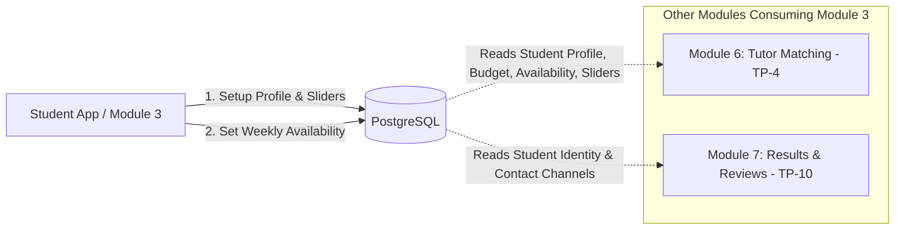

# API Specification — Module 3: Student Profile & Preferences

> **Jira Epic:** TP-50: Development — Student Profile & Preferences  
> **Sub-Tasks:**  
> • **TP-58**: Develop student profile functionality  
> • **TP-57**: Develop student learning preference functionality (1–5 Sliders)  
> • **TP-54**: Develop student availability and requirement (Budget, Tutor Type & Time Slots)  
>
> **Base URL:** `http://localhost:4000/api` (local) | `https://api.tutorpair.com/api` (production)  
> **Authentication:** `Authorization: Bearer <cognito-jwt>`  
> Local mock bypass: `Authorization: Bearer mock-token-<user-id>` (see [`AUTH_FLOW.md`](./AUTH_FLOW.md))  
> **Access Role:** Student endpoints require the `STUDENT` role enforced via backend `requireRole(['STUDENT'])` middleware.  

---

## 1. Executive Summary & Cross-Module Context

Module 3 handles everything related to the student's personal identity, contact information, academic level, pedagogical learning preferences (via 1–5 sliders), budget constraints, and recurring weekly schedule availability.



### How Other Modules Connect to Module 3:

1. **Module 6 — Tutor Matching (`TP-4`)**:
   * When a student submits a matching request, the matching engine extracts the student's baseline preferences from Module 3:
     * **Hard Filters**: Student's `grade_level` (G1–G12) and weekly `availabilities` (day of week + time range overlap).
     * **Scoring Dimensions**: Student's `style_profile` (5 sliders), `personality_profile` (4 sliders), `budget_max`, and `tutor_type_pref`.
   * *Cross-Module Rule*: Module 6's service must import `studentsRepository` directly (never `studentsService`). Module 3 exposes:
     ```typescript
     studentsRepository.getProfileWithAvailability(studentId: string): Promise<StudentWithAvailabilityDto | null>
     ```

2. **Module 7 — Matching Results, History & Reviews (`TP-10`)**:
   * When a tutor is confirmed, the confirmed tutor receives the student's contact channels (`phone_number`, `line_id`, `first_name`, `last_name`).
   * Review gating checks verify that the user submitting the review is a `STUDENT` who confirmed a lesson with that tutor.

---

## 2. Authentication & Identity Resolution

Clients **never** pass a `student_id` in route paths or request bodies for self-service endpoints (`/students/profile`, `/students/availability`).

1. Frontend sends Bearer JWT in the HTTP header:
   ```http
   Authorization: Bearer <token>
   ```
2. The `authenticate` middleware verifies the token and attaches `req.user` (`req.user.id`, `req.user.role`).
3. The `requireRole(['STUDENT'])` middleware ensures only authenticated students can access these endpoints.
4. The service/repository queries:
   ```sql
   SELECT * FROM students WHERE user_id = req.user.id;
   ```
5. **Security Guarantee:** Students cannot inspect, modify, or overwrite another student's profile.

---

## 3. Standard Response Envelope

All endpoints conform to [`ApiResponse<T>`](../packages/shared/src/types/index.ts):

### Success Structure (`200 OK`, `201 Created`):
```json
{
  "success": true,
  "data": { ... },
  "message": "Operation completed successfully"
}
```

### Error Structure (`400 Bad Request`, `401 Unauthorized`, `403 Forbidden`, `404 Not Found`):
```json
{
  "success": false,
  "message": "Human-readable error description",
  "details": null
}
```

---

## 4. Endpoints Summary

| Sub-Task | Method | Endpoint | Description | Frontend Client Use Case |
|---|---|---|---|---|
| **TP-58 / TP-57 / TP-54** | `GET` | `/students/profile` | Retrieve student profile, preferences & budget | Pre-fills `StudentProfilePage` and matching pre-checks |
| **TP-58 / TP-57 / TP-54** | `POST` | `/students/profile` | Create initial student profile & sliders | First-time onboarding / profile completion |
| **TP-58 / TP-57 / TP-54** | `PATCH` | `/students/profile` | Partially update student profile or preferences | Profile settings update & quick slider adjustments |
| **TP-54** | `GET` | `/students/availability` | Get recurring weekly availability slots | Populates student availability grid |
| **TP-54** | `PUT` | `/students/availability` | Overwrite recurring weekly availability slots | Saves weekly student schedule for matching overlap |

---

## 5. Detailed Endpoint Specifications

### 5.1. `GET /api/students/profile` (TP-58, TP-57, TP-54)

Retrieves the authenticated student's profile, contact channels, grade level, 1–5 learning/personality preferences, and budget.

* **Headers:** `Authorization: Bearer <token>`
* **Role:** `STUDENT`

#### Response `200 OK`
```json
{
  "success": true,
  "data": {
    "user_id": "9b1deb4d-3b7d-4bad-9bdd-2b0d7b3dcb6d",
    "email": "student@example.com",
    "first_name": "Pitchaya",
    "last_name": "Siriwong",
    "phone_number": "0891234567",
    "line_id": "pitchaya.s",
    "grade_level": "G10",
    "tutor_type_pref": "ANY",
    "style_profile": [3, 4, 2, 4, 3],
    "personality_profile": [4, 5, 3, 4],
    "budget_max": 650.00
  }
}
```

> **Note on `email`:** Extracted from the authenticated session (`users` table) for display as a readonly field.

#### Response `404 Not Found`
*(Returned when user is authenticated with `STUDENT` role but has not yet completed the initial profile)*
```json
{
  "success": false,
  "message": "Student profile not found",
  "details": null
}
```

---

### 5.2. `POST /api/students/profile` (TP-58, TP-57, TP-54)

Creates the student profile record upon initial registration/onboarding.

* **Headers:** `Authorization: Bearer <token>`
* **Role:** `STUDENT`
* **Validation Schema:** `StudentProfileSchema`

#### Request Body
```json
{
  "first_name": "Pitchaya",
  "last_name": "Siriwong",
  "phone_number": "0891234567",
  "line_id": "pitchaya.s",
  "grade_level": "G10",
  "tutor_type_pref": "ANY",
  "style_profile": [3, 4, 2, 4, 3],
  "personality_profile": [4, 5, 3, 4],
  "budget_max": 650.00
}
```

#### Field Validation Rules:
* `first_name`: Required string, 1–100 chars.
* `last_name`: Required string, 1–100 chars.
* `phone_number`: Optional string, max 20 chars. Valid Thai mobile format recommended (`08...`, `09...`, `06...`).
* `line_id`: Optional string, max 100 chars.
* `grade_level`: Required string matching G1–G12 (`'G1'` through `'G12'`).
* `tutor_type_pref`: Enum value from `TutorTypePref`: `'UNDERGRADUATE'`, `'FREELANCE'`, `'INSTITUTIONAL'`, or `'ANY'`.
* `style_profile`: Exactly 5 integer ratings, each between 1 and 5.
* `personality_profile`: Exactly 4 integer ratings, each between 1 and 5.
* `budget_max`: Positive number $> 0$ (maximum hourly rate in THB).

#### Response `201 Created`
```json
{
  "success": true,
  "data": {
    "user_id": "9b1deb4d-3b7d-4bad-9bdd-2b0d7b3dcb6d",
    "first_name": "Pitchaya",
    "last_name": "Siriwong",
    "phone_number": "0891234567",
    "line_id": "pitchaya.s",
    "grade_level": "G10",
    "tutor_type_pref": "ANY",
    "style_profile": [3, 4, 2, 4, 3],
    "personality_profile": [4, 5, 3, 4],
    "budget_max": 650.00
  },
  "message": "Student profile created successfully"
}
```

#### Response `409 Conflict`
*(If profile already exists for this user)*
```json
{
  "success": false,
  "message": "Student profile already exists for this user"
}
```

---

### 5.3. `PATCH /api/students/profile` (TP-58, TP-57, TP-54)

Updates any subset of profile fields, contact info, sliders, or budget.

* **Headers:** `Authorization: Bearer <token>`
* **Role:** `STUDENT`
* **Validation Schema:** `UpdateStudentProfileSchema` (all fields optional)

#### Request Body (Example: Updating contact and budget only)
```json
{
  "phone_number": "0819998888",
  "budget_max": 750.00
}
```

#### Request Body (Example: Updating slider ratings)
```json
{
  "style_profile": [4, 4, 3, 5, 3],
  "personality_profile": [5, 5, 4, 4]
}
```

#### Response `200 OK`
```json
{
  "success": true,
  "data": {
    "user_id": "9b1deb4d-3b7d-4bad-9bdd-2b0d7b3dcb6d",
    "first_name": "Pitchaya",
    "last_name": "Siriwong",
    "phone_number": "0819998888",
    "line_id": "pitchaya.s",
    "grade_level": "G10",
    "tutor_type_pref": "ANY",
    "style_profile": [4, 4, 3, 5, 3],
    "personality_profile": [5, 5, 4, 4],
    "budget_max": 750.00
  },
  "message": "Student profile updated successfully"
}
```

---

### 5.4. `GET /api/students/availability` (TP-54)

Retrieves the student's recurring weekly availability time slots.

* **Headers:** `Authorization: Bearer <token>`
* **Role:** `STUDENT`

#### Response `200 OK`
```json
{
  "success": true,
  "data": [
    {
      "id": "1a2b3c4d-0001-4000-8000-111122223333",
      "day_of_week": "MONDAY",
      "start_time": "17:00",
      "end_time": "19:00"
    },
    {
      "id": "1a2b3c4d-0002-4000-8000-111122223333",
      "day_of_week": "SATURDAY",
      "start_time": "10:00",
      "end_time": "12:00"
    }
  ]
}
```

---

### 5.5. `PUT /api/students/availability` (TP-54)

Overwrites the student's recurring weekly availability time slots. Existing slots for this user are replaced atomically in a single database transaction.

* **Headers:** `Authorization: Bearer <token>`
* **Role:** `STUDENT`
* **Validation Schema:** `SetStudentAvailabilitySchema`

#### Request Body
```json
{
  "slots": [
    {
      "day_of_week": "MONDAY",
      "start_time": "17:00",
      "end_time": "19:00"
    },
    {
      "day_of_week": "WEDNESDAY",
      "start_time": "17:00",
      "end_time": "19:00"
    },
    {
      "day_of_week": "SATURDAY",
      "start_time": "09:00",
      "end_time": "12:00"
    }
  ]
}
```

#### Validation Rules:
* `day_of_week`: `MONDAY` | `TUESDAY` | `WEDNESDAY` | `THURSDAY` | `FRIDAY` | `SATURDAY` | `SUNDAY`
* `start_time`, `end_time`: 24-hour format `HH:mm` (e.g., `"17:00"`).
* `start_time` must be strictly earlier than `end_time`.
* Slots on the same day must not overlap.

#### Response `200 OK`
```json
{
  "success": true,
  "data": [
    {
      "id": "3a1b2c4d-0001-4000-8000-111122223333",
      "day_of_week": "MONDAY",
      "start_time": "17:00",
      "end_time": "19:00"
    },
    {
      "id": "3a1b2c4d-0002-4000-8000-111122223333",
      "day_of_week": "WEDNESDAY",
      "start_time": "17:00",
      "end_time": "19:00"
    },
    {
      "id": "3a1b2c4d-0003-4000-8000-111122223333",
      "day_of_week": "SATURDAY",
      "start_time": "09:00",
      "end_time": "12:00"
    }
  ],
  "message": "Availability schedule updated successfully"
}
```

---

### 5.6. `GET /api/students/subjects`

Retrieves the student's selected target subjects with category and learning goal details.

* **Headers:** `Authorization: Bearer <token>`
* **Role:** `STUDENT`

#### Response `200 OK`
```json
{
  "success": true,
  "data": [
    {
      "variant_id": "var-math-school-uuid",
      "subject_name": "Mathematics",
      "variant_name": "School Curriculum Mathematics",
      "category": "GENERAL_LEARNING",
      "learning_goal": "SCHOOL_CURRICULUM"
    },
    {
      "variant_id": "var-sat-math-uuid",
      "subject_name": "Digital SAT",
      "variant_name": "Digital SAT Math (700+)",
      "category": "UNIVERSITY_ENTRANCE",
      "learning_goal": "STANDARDIZED_EXAMS"
    }
  ]
}
```

---

### 5.7. `PUT /api/students/subjects`

Replaces the student's selected target subject requirements.

* **Headers:** `Authorization: Bearer <token>`
* **Role:** `STUDENT`
* **Validation Schema:** `SetStudentSubjectsSchema` (`{ variant_ids: string[] }`)

#### Request Body
```json
{
  "variant_ids": [
    "var-math-school-uuid",
    "var-sat-math-uuid"
  ]
}
```

#### Response `200 OK`
```json
{
  "success": true,
  "data": [
    {
      "variant_id": "var-math-school-uuid",
      "subject_name": "Mathematics",
      "variant_name": "School Curriculum Mathematics",
      "category": "GENERAL_LEARNING",
      "learning_goal": "SCHOOL_CURRICULUM"
    }
  ],
  "message": "Student target subjects updated successfully"
}
```

---

## 6. TP-57: Learning Preferences 1–5 Slider Semantic Mapping

To guarantee perfect algorithmic alignment with Module 4 (Tutor Profile) and Module 6 (Matchmaking), the student prompts correspond to the exact same dimensions:

### 6.1. Learning Style (5 Sliders — Student vs Tutor Counterpart)

| # | Dimension Title | Student Prompt (Learning Style) | Tutor Prompt (Teaching Style) | Value 1 (Left Label) | Value 5 (Right Label) |
|---|---|---|---|---|---|
| **1** | Teaching Pace & Structure | I prefer learning... | I usually teach... | Step-by-step carefully | Focus on key points & move fast |
| **2** | Teaching Method | I prefer... | I focus more on... | Doing a lot of practice exercises | Understanding the concept first |
| **3** | Interaction Format | During class I like to... | I prefer... | Chat and discuss with the tutor | Quiet sessions focused on listening |
| **4** | Guidance Approach | I like tutors who... | I... | Guide me step-by-step | Let them explore independently |
| **5** | Lesson Atmosphere | I prefer... | I make lessons... | A fun and relaxed atmosphere | Calm and focused |

### 6.2. Personality Preferences (4 Sliders — Student vs Tutor Counterpart)

| # | Dimension Title | Student Prompt (Personality Preference) | Tutor Prompt (Self-Personality) | Value 1 (Left Label) | Value 5 (Right Label) |
|---|---|---|---|---|---|
| **1** | Communication Style | I prefer a tutor who is... | I am usually... | Formal and polite | Casual and friendly |
| **2** | Session Management | I want a tutor who is... | I... | Strictly on schedule / Always on time | Flexible and adaptable depending on situation |
| **3** | Energy Level | I like tutors who are... | I'm... | Calm, gentle & composed | Energetic and lively / expressive |
| **4** | Motivation Strategy | I prefer tutors who... | I motivate students by... | Focus on discipline / challenge | Encourage & praise / relaxed atmosphere |

---

## 7. Frontend Architecture & Component Consistency (Adaptation from Module 4)

To maintain consistent user experience across the platform, the frontend adapts proven patterns from Module 4 (`apps/client/src/features/tutors`):

```text
apps/client/src/features/students/
├── StudentProfilePage.tsx          # Main tabs / layout container
├── components/
│   ├── StudentProfileForm.tsx      # Personal Info (First/Last Name, Phone, LINE ID, Grade Level)
│   ├── StudentSliders.tsx          # 5 Learning Style + 4 Personality Sliders (adapted from TutorSliders)
│   ├── StudentAvailabilityGrid.tsx # Schedule selector (reusable AvailabilityGrid)
│   └── StudentRequirementsCard.tsx # Budget & Tutor Type preference selector
├── hooks/
│   ├── useStudentProfile.ts        # TanStack Query hook for GET /students/profile
│   ├── useUpdateStudentProfile.ts  # TanStack Mutation for PATCH /students/profile
│   └── useStudentAvailability.ts   # TanStack Query & Mutation for /students/availability
└── students.api.ts                 # Axios API calls with Bearer token interceptor
```

### Key Reusable Assets from Module 4:
1. [`SliderInput.tsx`](../apps/client/src/components/forms/SliderInput.tsx): Discrete 1–5 thumb slider with active value pill and left/right labels.
2. **Color Palette & Cards**:
   * Style Profile block uses `var(--color-primary-tint)` (`#EFF6FF`).
   * Personality Profile block uses `var(--color-secondary-tint)` (`#ECFDF5`).
   * Requirements & Budget block uses `var(--color-accent-tint)` (`#FFFBEB`).
3. **Availability Slot Management**: Identical time slot presets (*Morning 09:00–12:00*, *Afternoon 13:00–17:00*, *Evening 18:00–21:00*) and overlap validation.

---

## 8. Database Schema Mapping

### `students` Table:
```sql
CREATE TABLE students (
  user_id UUID PRIMARY KEY REFERENCES users(id) ON DELETE CASCADE,
  first_name VARCHAR(100) NOT NULL,
  last_name VARCHAR(100) NOT NULL,
  phone_number VARCHAR(20),
  line_id VARCHAR(100),
  grade_level VARCHAR(20) NOT NULL,
  tutor_type_pref tutor_type_pref_enum NOT NULL,
  style_profile INTEGER[] NOT NULL,
  personality_profile INTEGER[] NOT NULL,
  budget_max DECIMAL(10, 2) NOT NULL
);
```

### `availabilities` Table:
```sql
CREATE TABLE availabilities (
  id UUID PRIMARY KEY DEFAULT gen_random_uuid(),
  user_id UUID NOT NULL REFERENCES users(id) ON DELETE CASCADE,
  day_of_week day_of_week_enum NOT NULL,
  start_time TIME NOT NULL,
  end_time TIME NOT NULL
);
```

---

## 9. Verification & Testing Requirements

1. **Unit Tests** (`apps/server/src/modules/students/students.service.test.ts`):
   * Validation of 1–5 range bounds and array length enforcement (exactly 5 for style, 4 for personality).
   * Budget positive check.
   * Start time $<$ End time check and non-overlapping slot validation.
2. **Integration Tests** (`apps/server/src/modules/students/students.integration.test.ts`):
   * Role enforcement: Access denied for unauthenticated requests (`401`) and non-students (`403`).
   * Profile creation (`POST 201`), profile retrieval (`GET 200`), profile update (`PATCH 200`).
   * Atomic replacement of availability slots via `PUT /api/students/availability`.
3. **Studio Inspection**: Run `npm run db:studio` to visually inspect inserted and updated student records.
