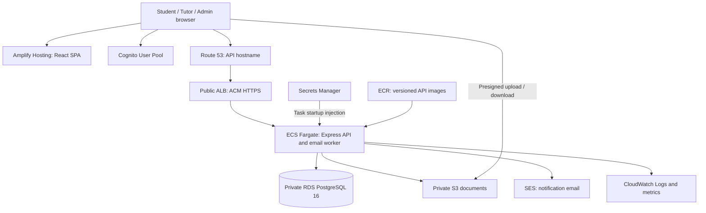

# TutorPair AWS setup plan

Prepared 2026-10-22. Status: proposed deployment plan; no AWS resources provisioned.

Accepted direction: one codebase that supports HA, regular single-instance deployment, and an HA configuration for testing. [HIGH_AVAILABILITY.md](./HIGH_AVAILABILITY.md) defines the profiles, application requirements, and evidence needed. Implementation and failover verification remain pending. The existing 99% availability target is unchanged.

This plan follows PROJECT_CONTEXT.md and the existing docs. New deployment choices below are recommendations for discussion, not replacements for recorded architecture decisions. The user selected a low-cost demo/pilot deployment. The exact monthly ceiling, existing AWS resources, domain ownership, and infrastructure tooling remain to be confirmed.

The authoritative component scope is the user's replacement [Cloud Components table](./CLOUD_COMPONENTS.md), supplied directly on 2026-10-22. It supersedes the earlier Word document and its screenshots. The agreed stack includes Amplify, Route 53, ALB, ACM, ECS Fargate, ECR, RDS PostgreSQL, S3, Cognito with Google OAuth, SES, CloudWatch, VPC, security groups, IAM, and Secrets Manager. Private ECS and RDS remain the planning baseline for the table's private-networking intent; specific subnet and outbound-connectivity choices are proposed deployment details. See [AWS_ALIGNMENT_REVIEW.md](./AWS_ALIGNMENT_REVIEW.md) for implementation evidence. Deployed AWS account state has not been inspected.

## 1. Project understanding

TutorPair serves Thai G1–G12 students, tutors, and administrators. Tutors submit credentials for administrator approval; only approved tutors enter deterministic matching. Students select category → subject → variant, supply learning preferences, receive up to three recommendations, and confirm one tutor. Reviews require a confirmed relationship and cover four rating categories.

Infrastructure must support private qualification documents, role authorization from PostgreSQL, consent-controlled CV access, and durable notification records. Existing requirements target 100 concurrent users, 95% of normal matching requests under three seconds, 99% availability, and seven days of database backups. These are acceptance targets to measure, not guarantees from selecting AWS services.

## 2. Target architecture

The SPA contacts the API directly from the browser. Amplify does not proxy the API by default. DNS resolves names; it does not transport application requests.

Use `ap-southeast-1` (Singapore) as the initial planning region because the repository already defaults to it. Validate account availability, service support, latency, and any data-location requirements before provisioning. A Thailand region deployment is an alternative to evaluate if in-country hosting is required; it is not assumed here.

## 3. Resources and sizing proposals

| Component | Initial proposal | Production considerations |
|---|---|---|
| Frontend | Amplify Hosting for `apps/client` | Separate deployment environment and Cognito callbacks for production |
| Image registry | Private ECR repository; immutable commit tags | Scanning and lifecycle rules retaining rollback images |
| API | Fargate Linux task, initially 0.5 vCPU / 1 GiB | Load-test before final sizing; two tasks across AZs for real users |
| Load balancer | Internet-facing ALB across two AZs | HTTPS 443; HTTP redirects to HTTPS; IP target group on port 4000 |
| Database | RDS PostgreSQL 16; small burstable instance, encrypted general-purpose storage | Multi-AZ for real users; validate instance class and engine minor version at deployment |
| Documents | Private S3 bucket per environment | Block public access, encryption, TLS-only policy, explicit retention decisions |
| Identity | Cognito User Pool and public SPA app client without client secret | Email verification, password reset, Google federation, admin MFA policy |
| Email | SES verified sender domain | DKIM, SPF/DMARC configuration, production access, bounce/complaint handling |
| Secrets | Database URL in Secrets Manager | Separate runtime and migration DB credentials; redeploy tasks after injected-secret changes |
| Monitoring | CloudWatch log group and alarms | Defined retention, alert destination, database and email backlog visibility |

These starting sizes are estimates to validate. A small database or task is not evidence that the performance targets are met.

## 4. Networking and identity boundaries

Team-aligned demo layout: one VPC across two Availability Zones, with two public ALB subnets, two private application subnets, and two isolated database subnets. Initially run one ECS task and Single-AZ RDS; subnet coverage across two AZs does not make these resources highly available. ECS tasks have no public IP. Private application subnets need outbound connectivity for Cognito JWKS fetching and AWS service calls. Budget for one NAT gateway initially, accepting its failure dependency and possible cross-AZ traffic charges. Evaluate VPC endpoints against actual costs and dependencies. Endpoints alone do not automatically solve access to Cognito's public JWKS endpoint. Production can add NAT redundancy and increase API/database availability after budget and reliability review.

Security group rules:

- ALB: inbound TCP 443 from browsers; TCP 80 only for HTTPS redirect.
- ECS: inbound TCP 4000 only from the ALB security group.
- RDS: inbound TCP 5432 only from the ECS security group and an explicitly authorized migration/administration path. No public database endpoint.
- Database administration: use a temporary authenticated tunnel into the VPC, such as an SSM-managed host, when needed. Do not expose RDS publicly for Drizzle Studio.

Separate IAM roles:

- Task execution role: ECR image pulls, log delivery, and access to the specific startup secrets.
- Application task role: only the required S3 object operations/prefixes and SES sending identity. No static AWS keys in the container.
- Deployment role: restricted image push, task registration, service update, and necessary `iam:PassRole` permissions. Prefer short-lived CI federation.
- Migration role/database user: only the deployment process receives schema-changing privileges.

Keep local mock authentication functional. Set `NODE_ENV=production` on ECS and verify that production rejects mock tokens.

## 5. Cost profiles to choose between

Accepted regular profile: **single-instance demo/pilot, keep costs low**. Use one private API task and Single-AZ RDS. One NAT gateway and short log retention are cost proposals. Build all concurrency and recovery protections into the shared codebase before testing the second profile; do not disable them in regular deployment. Preserve the team's agreed stack. Do not enable autoscaling until concurrent processing is verified.

**Demo/pilot:** one private API task, Single-AZ RDS with a subnet group covering two AZs, small storage, short log retention, and a deliberate teardown schedule. Keep the ALB public and both ECS and RDS private as the planning baseline. Public-subnet ECS with ALB-only ingress was discussed as a cost-saving alternative; it has not been selected. If the estimate exceeds the budget, discuss that alternative explicitly instead of silently changing the private-network boundary.

**Accepted HA testing profile:** at least two private API tasks across two AZs, desired/minimum count at least two, Multi-AZ RDS primary/standby, and outbound routing that survives either AZ failing. For the proposed zonal NAT layout, use one per AZ with AZ-local routes. Verify worker concurrency, surviving-task capacity, health-checked rolling deployment/rollback, and recovery before describing observed HA results. Use the same application release as the regular profile. Deployment details, cost, and failure-test limits must be finalized before provisioning.

Keep HA test infrastructure active only for the planned test window if cost requires it. Do not assume switching profiles is instant or that changing database availability settings is disruption-free. Plan preservation of data, recovery, and post-test resource cleanup. This decision does not authorize provisioning or failover now. One task/Single-AZ operation remains a reduced-availability deployment even after a successful HA test elsewhere or earlier.

Build an AWS Pricing Calculator estimate after choosing the profile. Include Fargate, ALB hours/capacity, RDS compute/storage/backups, NAT hours/data processing or endpoints, public IPv4, Amplify builds/bandwidth, S3, CloudWatch, Secrets Manager, DNS, Cognito, SES, and data transfer. Do not assume free-tier eligibility. Create AWS Budgets alerts first; alerts do not enforce a spending cap.

## 6. Repository readiness findings

Inspection found these gaps; none were changed by this planning task:

1. Most feature routes, services, controllers, and repositories remain TODO scaffolds. Infrastructure can first host `/api/health`, but a working product requires implementing the documented business flows.
2. `apps/client/src/features/auth/LoginPage.tsx` signs in mock users only. Implement real Cognito sign-up/sign-in, recovery, session handling, and Google redirect configuration before a public pilot.
3. `/api/auth/sync` is not implemented. Its first-login path must verify a JWT before a database user exists, allow public registration only as STUDENT or TUTOR, and provision ADMIN through a privileged operation.
4. `apps/server/src/workers/email-dispatch.worker.ts` contains no dispatch implementation. Add retries, safe claims across processes, bounded batches, and failure visibility. Database durability does not guarantee exactly-once email delivery, and rolling deployments can overlap workers even with desired task count one.
5. `apps/server/src/config/env.ts` defaults required production settings to local/mock values. Add strict production validation while preserving convenient local development.
6. The Dockerfile pins Node 20, which is end-of-life as of this plan. Move to a currently supported LTS version and verify dependency compatibility.
7. There is no `.dockerignore`. Add exclusions for local environment files, credentials, node_modules, Git metadata, and build output before building images.
8. Migration execution currently expects `./src/db/migrations`; the runtime image copies only compiled output and omits migration SQL. Package SQL files and provide a compiled migration command with a known working directory for a one-off ECS task.
9. `db/client.ts` has no explicit RDS certificate/TLS or pool sizing configuration. Configure trusted CA verification and bound total connections across API tasks and migration jobs.
10. No workspace declares a test script. The root `npm test` uses `--if-present`, so it can succeed without running tests. Add actual scoring unit tests and API integration tests before calling the deployment verified.
11. Amplify needs root workspace installation and a shared-package build. The architecture document's phrase “reads apps/client only” must not lead to omitting `packages/shared` during builds.
12. `/api/health` currently reports process liveness only. Add a separate database readiness check so a green ALB target is not treated as proof that application dependencies work.

For documents, implement authorization and upload confirmation checks against actual S3 object metadata, not just client-reported file sizes. Honor the 10 MB/file and 100 MB/tutor limits. Expiring presigned URLs remain shareable until expiry; their lifetime alone does not enforce consent or recipient identity.

## 7. Deployment sequence and completion checks

| Phase | Work | Completion evidence |
|---|---|---|
| 1. Account foundation | Confirm account/profile/domain; root MFA, named administrative access, budgets, tags, audit trail | Budget alerts configured; no root access keys |
| 2. Deployment decisions | Choose demo vs real users, region, budget, IaC tool, DNS names and environment boundaries | Recorded decisions and calculator estimate |
| 3. Network and persistence | VPC/subnets/routing/security groups; encrypted private RDS; seven-day backups; S3; secrets | Database accessible only through approved paths; backup configuration inspected |
| 4. Identity and email | Cognito SPA client, callback/logout URLs, Google IdP; SES domain verification and production access request | Real test user obtains JWT; verified sender works within account sending restrictions |
| 5. Container baseline | Supported Node LTS, Docker context exclusions, root build, image pushed to ECR; IAM roles | Container starts without local environment files or static credentials |
| 6. API infrastructure | ALB certificate and DNS; ECS task definition, service, logs, health checks | HTTPS `/api/health` works; logs visible; RDS readiness verified |
| 7. Database release | One-off ECS migration task inside VPC; reviewed reference-data seeding | Successful exit code, migration journal checked, required subjects present |
| 8. Frontend release | Amplify monorepo build and SPA fallback; public build variables; API/S3 CORS | Direct links load; browser reaches API and S3 without CORS errors |
| 9. Feature pilot | Complete auth, profiles, verification, documents, matching, reviews, email | Student → tutor selection → email and admin approval flows demonstrated |
| 10. Operational validation | Tests with one/two processes, HA profile task/DB/AZ dependency exercises, load/restore/rollback tests, alerts | Release and topology recorded; measured errors/recovery; no duplicate business events; restore and rollback demonstrated |

Infrastructure as code is recommended, but the repository does not mandate Terraform, CDK, or CloudFormation. Choose with the team before implementation. Do not provision a second paid environment automatically; use local development plus one AWS pilot initially if budget requires it.

Amplify build outline: run `npm ci` at the repository root, `npm run build:shared`, and `npm run build:client`; publish `apps/client/dist`. Configure `appRoot: apps/client`, root build path, and the matching `AMPLIFY_MONOREPO_APP_ROOT` setting. Verify the actual build specification and SPA rewrite behavior in a preview deployment.

Backend release outline: test/build → build image from repository root → push immutable image → run migration task once → update ECS service → wait for health → smoke test. Use backward-compatible migrations; rolling back an image does not roll back a database migration.

Do not run the local reference seed blindly on production: review repeatability and data contents first. After migrations or seeding, the human developer must run `npm run db:studio` through an authorized database connection and inspect https://local.drizzle.studio for tables, relations, and reference data.

## 8. Environment configuration

Backend non-secret settings: `PORT=4000`, `NODE_ENV=production`, `AWS_REGION`, `ALLOWED_ORIGIN`, `COGNITO_USER_POOL_ID`, `COGNITO_CLIENT_ID`, `S3_BUCKET_NAME`, and `SES_FROM_EMAIL`. Inject `DATABASE_URL` from Secrets Manager. RDS CA material is public configuration, not a secret.

Frontend public build settings: `VITE_API_BASE_URL`, `VITE_AWS_REGION`, `VITE_COGNITO_USER_POOL_ID`, and `VITE_COGNITO_CLIENT_ID`. Additional Google OAuth redirect/domain settings require application implementation. Never put database credentials, AWS keys, or an OAuth client secret in `VITE_*` variables.

Set the API origin and S3 CORS origins to the actual frontend URL. Decide how previews authenticate and access data; do not give arbitrary preview domains production document access.

## 9. Verification commands and feature checks

- Run `npm run build` for all three workspaces.
- Run `npm test` after adding real workspace test scripts; check that tests actually execute.
- Build the backend using `docker build -t tutorpair-server -f Dockerfile .` and test the image using non-production secrets before pushing it.
- Apply reviewed migrations with `npm run db:migrate` in the supported development workflow; cloud releases need the packaged migration entry point described above.
- Run `npm run db:studio` and inspect https://local.drizzle.studio after migrations/seeding through the approved access path.
- Verify unauthenticated requests return 401, students cannot access admin endpoints, production rejects mock tokens, tutors cannot approve themselves, and public registration cannot create administrators.
- Verify private S3 objects reject unsigned access, authorized uploads work, size/quota checks work, and CV consent is enforced.
- Verify two overlapping worker instances do not independently claim the same notification, failures are retryable, and one tutor selection creates the intended notification.
- Verify the same release with one API/worker and then with multiple processes. Run the HA failure exercises in [HIGH_AVAILABILITY.md](./HIGH_AVAILABILITY.md); record actual deployment settings and recovery results. An unexecuted HA configuration is not evidence of HA.
- Load-test representative data at 100 concurrent users; measure matching and page/API latency against PROJECT_CONTEXT.md rather than treating the health check as an application acceptance test.

## 10. External reference checks

- [ECS outbound networking](https://docs.aws.amazon.com/AmazonECS/latest/developerguide/networking-outbound.html): public-IP and private-subnet/NAT options.
- [Amplify monorepo builds](https://docs.aws.amazon.com/amplify/latest/userguide/monorepo-configuration.html): application root and build path settings.
- [RDS PostgreSQL TLS](https://docs.aws.amazon.com/AmazonRDS/latest/UserGuide/PostgreSQL.Concepts.General.SSL.html): encryption and server certificate verification.
- [ECS Secrets Manager injection](https://docs.aws.amazon.com/AmazonECS/latest/developerguide/secrets-envvar-secrets-manager.html): execution-role access and task restart requirements.
- [SES regional behavior](https://docs.aws.amazon.com/ses/latest/dg/regions.html): identities, sandbox status, and quotas are regional.
- [Node.js release schedule](https://github.com/nodejs/Release): supported release lines and Node 20 end-of-life.
